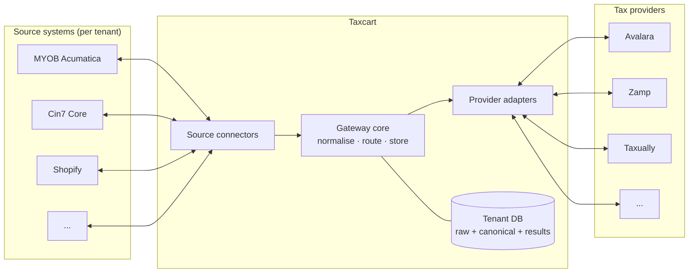
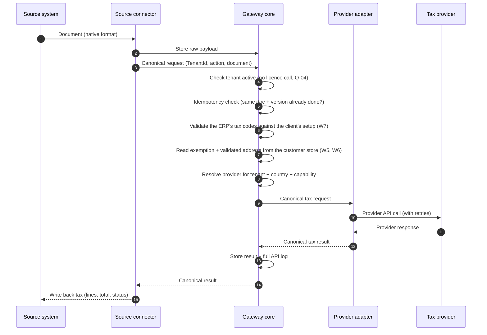
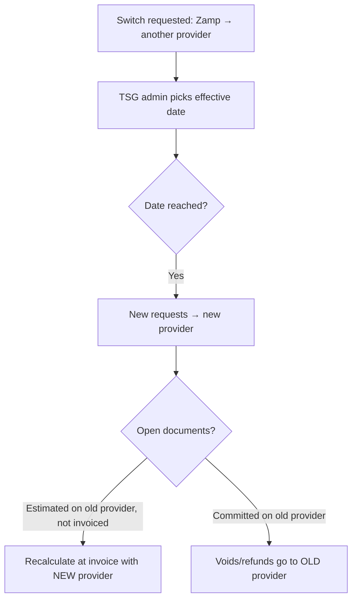
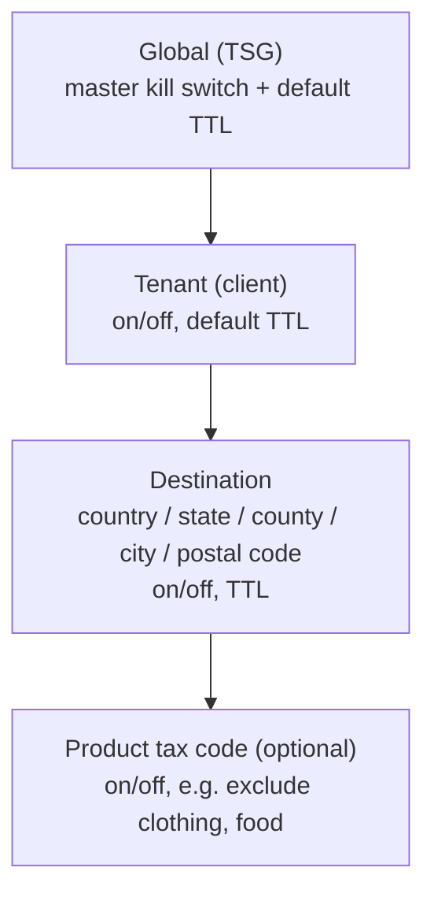
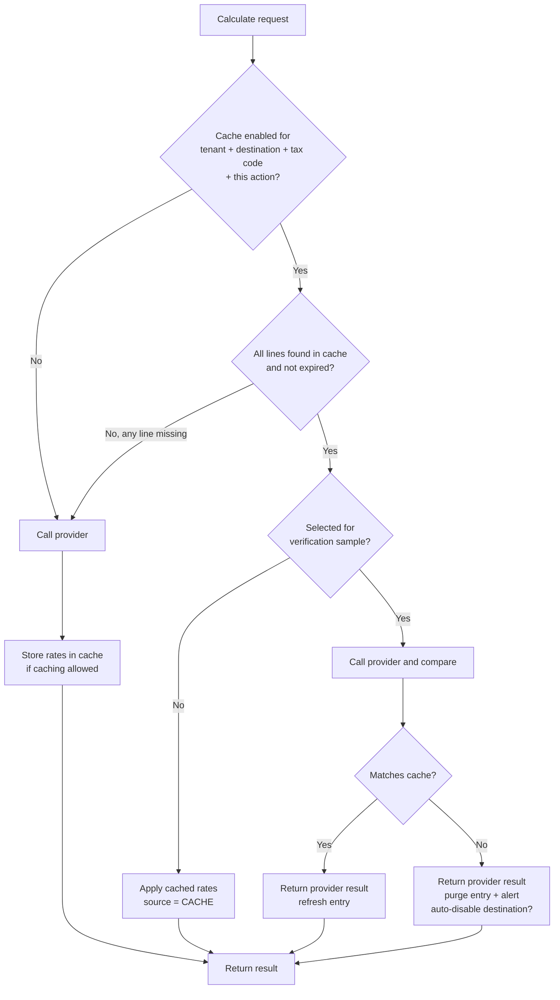
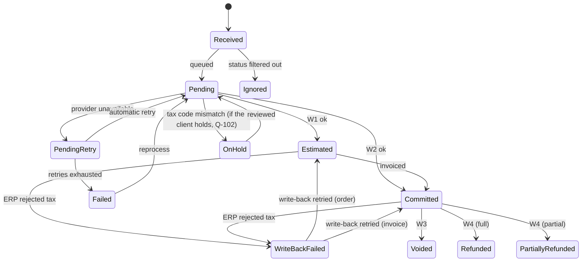

# 01 — Core Workflows

**Status:** Draft v0.2 · **Date:** 2026-11-22 · **Owner:** TSG

This document covers *how requests flow* through **Taxcart**. It doesn't cover data models, UI or infrastructure; those have their own documents.

> **MVP scope (answers Q-06, Q-10, Q-14):** US sales tax only. One source system, **Cin7 Omni**. One tax provider, **Zamp**, using the merchant's own Zamp account (Q-03). Documents: **sales orders and invoices**. MVP workflows: W1, W2, W5, W6, W7, W8, plus W3 if Q-103 confirms it. W4 and W9 come later. The design stays multi-country and multi-provider, because Q-23 confirms more countries and providers follow (Taxually for the UK, 1StopVAT for the EU).

---

## 1. Actors

| Actor | Description |
|---|---|
| **Source system** | ERP, finance or eCommerce app (MYOB Acumatica, Cin7 Core/Omni, Unleashed, Shopify, ...). Creates orders and invoices. Usually has no tax engine of its own. |
| **Source connector** | Gateway component that talks to one source system type: receives or pulls documents and writes results back. |
| **Gateway core** | Provider-neutral logic: normalise, decide, route, store, return. |
| **Provider adapter** | Gateway component that talks to one tax provider (Avalara, Zamp, Taxually, ...). |
| **Tax provider** | External tax calculator. Calculates tax, records committed transactions, and in some cases files returns. |
| **TSG admin** | Onboards clients (Q-25), configures connectors, status mappings and providers, and switches providers (Q-21). A separate TSG consultant role is open (Q-101). |
| **Merchant admin** | Merchant staff using the portal. Views transactions **read-only** (Q-20). Whether they can edit anything else is open (Q-100). The merchant's own customers have **no** portal access. |

## 2. Big picture

The **gateway core** never contains source-specific or provider-specific code. It only speaks the **canonical model**.

## 3. How requests arrive (trigger modes)

Most finance systems can't call out to a tax engine on their own, so the gateway has to support more than one way of getting requests in. Which modes each source supports is in Q-10 to Q-12.

| Mode | How it works | Tax in ERP before posting? | Example |
|---|---|---|---|
| **A. Real-time call** | An ERP customisation (button, save event) calls the gateway API and waits for the answer. | Yes | MYOB Acumatica "Calculate Tax" button |
| **B. Event push** | The ERP sends a webhook on create/update. The gateway calculates and writes tax back through the ERP API. | Yes (a few seconds later) | Shopify, Cin7 webhooks |
| **C. Scheduled pull** | The gateway polls the ERP for new or changed documents, calculates, and writes back. | Depends on the polling interval | Systems with no webhooks |

> **REQ-WF-1** Every connector declares which modes it supports. A tenant's connector is configured to one or more of them.
> **REQ-WF-10** Tax should be in the ERP document **before it's posted** (Q-11). Use the most real-time mode the ERP supports: A before B before C. The chosen mode is recorded per client.
> **REQ-WF-11** **Write-back is mandatory** for an MVP connector (Q-13). A connector declares how it can accept tax: per line, per document, or not at all. A source that can't accept externally calculated tax can't be onboarded until a workaround is agreed. See [04-connectors.md](04-connectors.md).

## 4. Generic request pipeline

Every action (calculate, commit, void, ...) goes through the same pipeline:

> **REQ-WF-2** Every inbound payload is stored raw before it's processed.
> **REQ-WF-3** Every outbound provider call is logged with its request, response, duration and outcome.
> **REQ-WF-4** Each action is idempotent on the key (TenantId, SourceSystem, DocumentId, DocumentVersion, Action).
> **REQ-WF-5** Provider calls retry with backoff. If they still fail, the transaction is marked *PendingRetry* and the user is told (see "Provider unavailable" below). An automatic retry job tries again later. After the retry limit it's marked *Failed* and shows up in the portal for reprocessing.
> **REQ-WF-9** **Parallel calculation:** after the primary engine's result is returned, the same canonical request is queued to the challenger engines (TSG cache, TSG rules, an optional second provider). All results are stored and compared. See [09-roadmap.md](09-roadmap.md).

## 5. Workflows

### Every document: three checks (Q-30)

US sales tax depends on three things, and Taxcart checks all three for **every document on every call**:

1. **Customer exemption:** is the customer exempt, with a valid certificate for the ship-to state? (W6)
2. **Address validation:** is the ship-to address valid, and which tax jurisdictions is it in? (W5)
3. **Tax calculation:** the tax itself (W1 or W2).

Checks 1 and 2 don't need to wait on the provider every time. Taxcart keeps a **customer & address store** per tenant: validated addresses, exemption status, certificate expiry, and when each was last checked. The calculation reads the store. A background job refreshes entries when the customer or address changes in the ERP, and when an entry is due for a recheck (frequency: Q-108). If an entry is missing, the check runs in line before the calculation.

> **REQ-WF-12** Every calculation applies a current exemption status and a validated ship-to address. The result records where each came from (store or live check) and when it was last checked.
> **REQ-WF-13** Customers are matched between the ERP and the provider by **customer code**, then **tax ID** (Q-33).
> **REQ-WF-14** The document currency must be the currency of the ship-to country (USD for the US, GBP for the UK, EUR for the EU). There's no currency conversion (Q-34). A mismatch is rejected.
> **REQ-WF-15** One ship-from address per document in the MVP (Q-17). Line-level ship-from (drop-ship, several warehouses) is on the roadmap.

### W1 — Calculate tax (estimate)
**When:** a sales order is created or changed (quotes come later, Q-14).
**What:** returns tax per line and in total. **Nothing is recorded with the provider** (uncommitted / estimate). Order tax is an **estimate only** (Q-31).
**Inputs:** ship-from (warehouse), ship-to, customer (code, tax ID, exemption), lines (item, ERP tax code, quantity, amount, discount), freight, currency, date.
**Output:** tax per line, tax by jurisdiction (state, county, city, special district), total tax, the validated address, and the tax code validation result per line (W7).

### W2 — Commit tax (invoice)
**When:** an invoice is posted (the trigger status is configured per client, Q-15).
**What:** recalculates tax and records a **committed** transaction with the provider (the provider uses it for reporting and filing). The invoice is the document tax authorities look at (Q-31).
**Rules:**
- All three checks (exemption, address, tax) are **redone at invoice**. Nothing is reused from the order, and the cache is never used for commits (REQ-CACHE-6).
- The invoice always wins. The difference from the order estimate is kept for reporting, but it isn't an alert.

### W3 — Void / cancel
**When:** an invoice is voided or cancelled in the ERP.
**What:** voids the committed transaction with the provider that committed it.
**MVP:** recommended, so a cancelled invoice isn't filed. To confirm (Q-103).

### W4 — Refund / credit note
**When:** a credit note or return is created against an invoice.
**What:** creates a refund/return transaction with the provider (full or partial lines).
**MVP:** no. Credit notes follow after the MVP (Q-14).

### W5 — Address validation
**When:** **every document** (Q-30), through the customer & address store. Refreshed in the background when the address changes or is due for a recheck.
**What:** validates and standardises the ship-to address and finds its tax jurisdictions. Can write the corrected address back to the ERP where the connector supports it.
**Provider:** can differ from the tax provider (REQ-WF-8). Which provider does it in the MVP is open (Q-105).

### W6 — Exemption check
**When:** **every document** (Q-30), through the customer & address store. Refreshed when the customer changes in the ERP, and before the certificate expires.
**What:** asks the provider whether the customer is exempt (for ship-to state / entity use). Writes the exempt flag back to the ERP where the connector supports it (Q-32). Taxcart **doesn't store certificates**, only status, reference and expiry date.

### W7 — Master data sync and tax code validation
**What:** keeps customers and warehouses (ship-from) in step between the ERP and Taxcart, and keeps each client's **expected product → tax category mapping** current.
**Tax codes (Q-16):** the product tax code lives in the ERP, but it may be wrong. On every document, Taxcart compares the code on each line with the client's product setup and records the result per line:

| Result | Meaning |
|---|---|
| `match` | ERP code agrees with the setup |
| `mismatch` | ERP code differs from the setup |
| `unknown_product` | Product isn't in the setup |
| `invalid_code` | Code isn't valid for the provider (e.g. not a Zamp product tax code) |

> **REQ-WF-16** Every line's tax code is validated on every document. The result is stored with the transaction and listed in a **tax code exceptions** view.
> **REQ-WF-17** Which code is used on a `mismatch` (the ERP's, the setup's, or hold the document for review) is a per-client setting. The default is to be decided (Q-102).

### W8 — Switch tax provider
**Who:** TSG admin only (Q-21). Merchant admins see the current provider.
**What:** changes a tenant's active provider from a **chosen effective date** (Q-22), which can be today. No ERP change needed.

> **REQ-WF-6** Every stored transaction records which provider (and provider account) produced it.
> **REQ-WF-7** Voids and refunds are always sent to the provider that committed the original transaction, even after a switch.
> **REQ-WF-8** The provider for each capability can be chosen separately: tax calculation, address validation and exemption.

### Provider unavailable (Q-35)

If the provider can't be reached after retries:

| Trigger mode | What the user sees |
|---|---|
| A. Real-time call | A clear message in the ERP: "Tax could not be calculated. Taxcart will retry and update this document." |
| B/C. Push or pull | A note or status written back to the ERP document, where the connector supports it, saying tax is pending |
| All | The document appears in the portal as *PendingRetry*, then *Failed* if retries run out |

> **REQ-WF-18** Taxcart never returns zero tax, and never guesses, when the provider is down. It tells the user and recalculates later.
> **REQ-WF-19** An automatic retry job recalculates *PendingRetry* documents and writes the tax back.
> **Roadmap:** once a Taxcart engine is proven for a scope ([09-roadmap.md](09-roadmap.md)), it can **suggest** Taxcart rates while the provider is down.

### W9 — Tax rate cache to cut cost (roadmap, not MVP)

> The cache is one of the engines in parallel calculation ([09-roadmap.md](09-roadmap.md)). It runs as a **challenger** until the evidence makes it eligible to be primary for a scope. The verification sampling below still applies once it's primary.
**Q-03 effect:** clients use their own provider accounts, so reuse cuts the **merchant's** provider cost and is kept per tenant. This implies answers to Q-40 and Q-42, to be confirmed (Q-109).

**Idea:** tax rates for a given product and destination rarely change. If a request matches a rate we already got from the provider, and that cached rate is still valid, **apply the cached rate instead of paying for a provider call**.

**Principle:** the cache can be wrong at any time. Because of that, it's **fully configurable, can be switched off at any level, always expires, and every result says whether it came from the cache or the provider.**

#### W9.1 Cache key

The cache stores **jurisdiction rates**, not tax amounts. The amount is recalculated for each request from the cached rates.

| Key part | Notes |
|---|---|
| TenantId | Cache is per tenant by default (sharing across tenants: Q-42) |
| Provider + provider account | Rates from Avalara are never reused for Zamp |
| Product tax code | Not the SKU. Many SKUs share one tax code. |
| Ship-from jurisdiction | Origin-based states need it |
| Ship-to **destination** | Country → state → county → city → postal code (ZIP+4 / rooftop for US). See W9.3. |
| Customer exemption status / entity use code | An exempt customer never gets a taxable cached rate |
| Tax date | Must fall inside the entry's validity window |

#### W9.2 Configuration levels

The settings are on/off, expiry (TTL), and which actions may use the cache. **The most specific level wins.** Any level can set `enabled = false`, and that overrides everything below it.

| Setting | Global | Tenant | Destination | Product tax code |
|---|---|---|---|---|
| `enabled` | ✅ kill switch | ✅ | ✅ | ✅ |
| `ttl` (e.g. 30 days) | ✅ default | ✅ | ✅ | — |
| `expireOnRateChangeDates` (e.g. 1 Jan / 1 Apr / 1 Jul / 1 Oct) | ✅ default | ✅ | ✅ | — |
| `allowedActions` (W1 estimate / W2 commit) | ✅ | ✅ | — | — |
| `verificationSampleRate` (W9.5) | ✅ | ✅ | ✅ | — |

Example: a tenant turns the cache **on** with a 90-day TTL, **off** for California (frequent local district changes), and sets a 7-day TTL for Colorado home-rule cities.

> **REQ-CACHE-1** The cache is off by default. It's enabled explicitly at tenant level.
> **REQ-CACHE-2** Settings can be configured at the global, tenant, destination and product tax code levels. The most specific level wins, and `enabled = false` at a higher level always wins.
> **REQ-CACHE-3** Every cache entry has an expiry. An entry with no TTL can't be stored.
> **REQ-CACHE-4** An entry expires at the **earliest** of its TTL, the next configured rate-change date, or a manual purge.
> **REQ-CACHE-5** Config changes take effect immediately. Turning a level off doesn't need a deploy or restart.
> **REQ-CACHE-6** By default only W1 (estimate) uses the cache. W2 (commit) is always sent to the provider unless the tenant explicitly allows the cache for commits **and** the provider isn't filing their returns (Q-41).

#### W9.3 Destination levels

"Destination" can be configured at any of these levels. A more specific setting wins:

`Country` → `State/Region` → `County` → `City` → `Postal code`

The **lookup** always matches at full precision (the jurisdictions returned by the provider, or the rooftop/ZIP+4 address). In the US one 5-digit ZIP can span several tax rates, so we never treat a match on a 5-digit ZIP alone as a hit.

#### W9.4 Flow

- **All lines or nothing:** if any line misses the cache, call the provider for the whole document. We never mix cached and live rates in one document.
- **Amount-dependent rules:** product tax codes with thresholds, caps or per-unit taxes (e.g. clothing under a price limit, single-item caps) can't be calculated from a rate. They're excluded through the product tax code level.

#### W9.5 Safety nets

> **REQ-CACHE-7** Every stored tax result records `source = PROVIDER | CACHE`, the cache entry ID and the entry's original provider response time.
> **REQ-CACHE-8** **Verification sampling:** a configurable % of cache hits are also sent to the provider and compared. A mismatch purges the entry, raises an alert, and (configurable) switches the cache off for that destination.
> **REQ-CACHE-9** **Manual purge:** TSG admins and tenant admins can purge by tenant, destination or product tax code from the portal.
> **REQ-CACHE-10** The entire cache for a tenant is purged when the tenant switches provider (W8) or provider account.
> **REQ-CACHE-11** The portal reports cache hit rate, provider calls saved and verification mismatches per tenant and destination.

> **REQ-CACHE-12** Cache settings are managed only through the dedicated cache screens (client and admin). Any active **Tax Change Event** forces live calculation for its scope. See [02-configuration.md](02-configuration.md) §7–8.

**Still to confirm:** Q-40 to Q-48.

## 6. Transaction states

## 7. Not in this document
- Configuration, onboarding and cache UI → [02-configuration.md](02-configuration.md)
- Canonical field list → 03-domain-model.md
- Source connectors and capabilities → [04-connectors.md](04-connectors.md)
- Provider adapter interface → 05-providers.md
- Portal screens and reports → 07-portal-reporting.md
