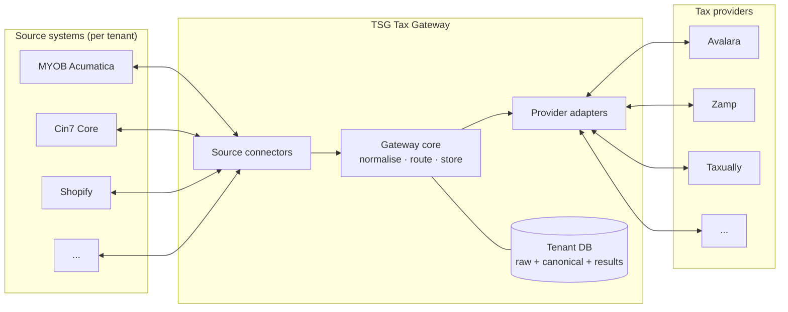
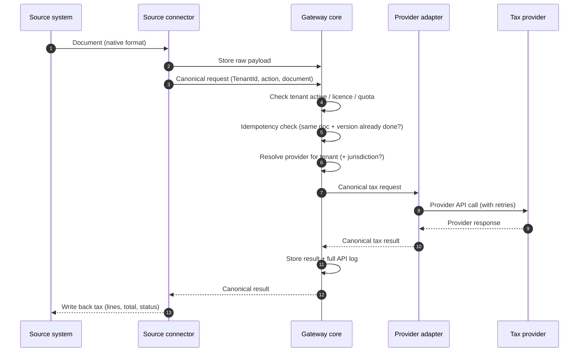
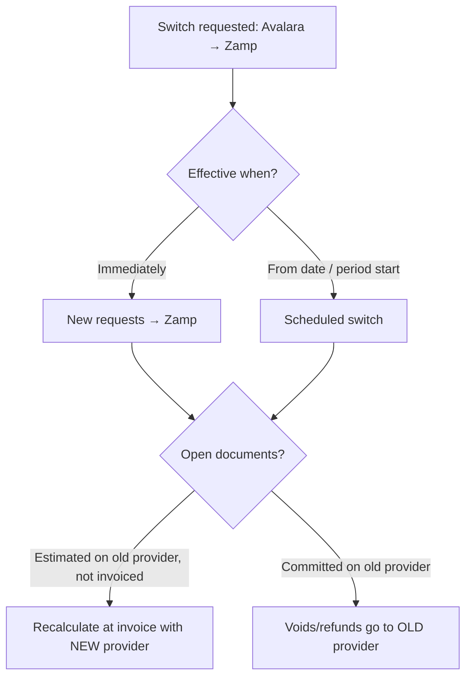
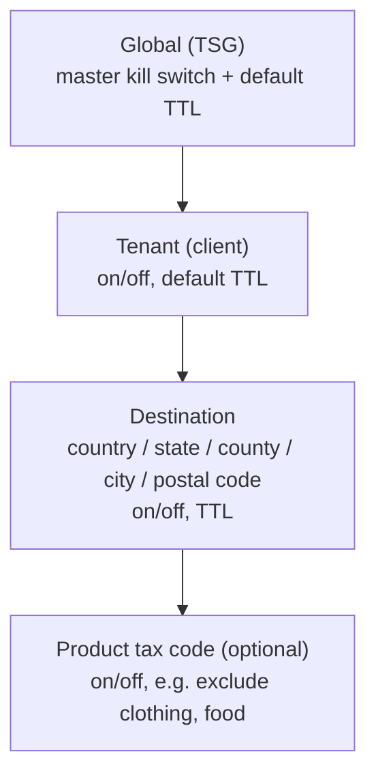
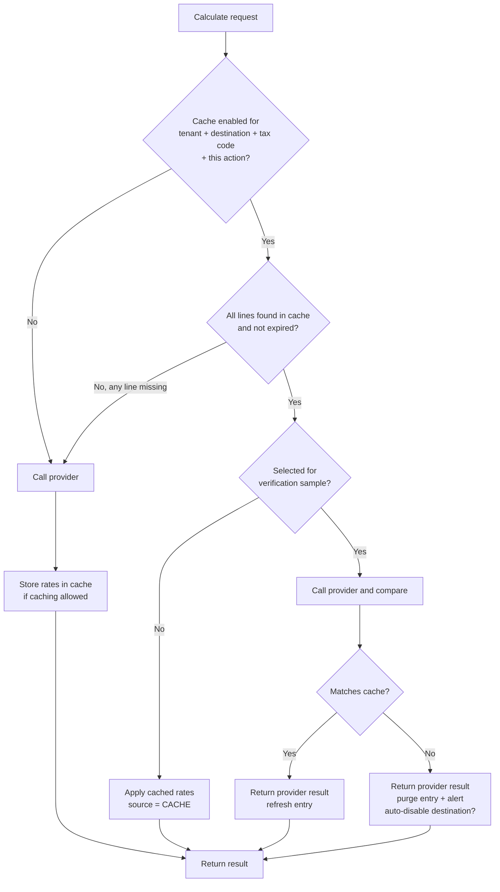
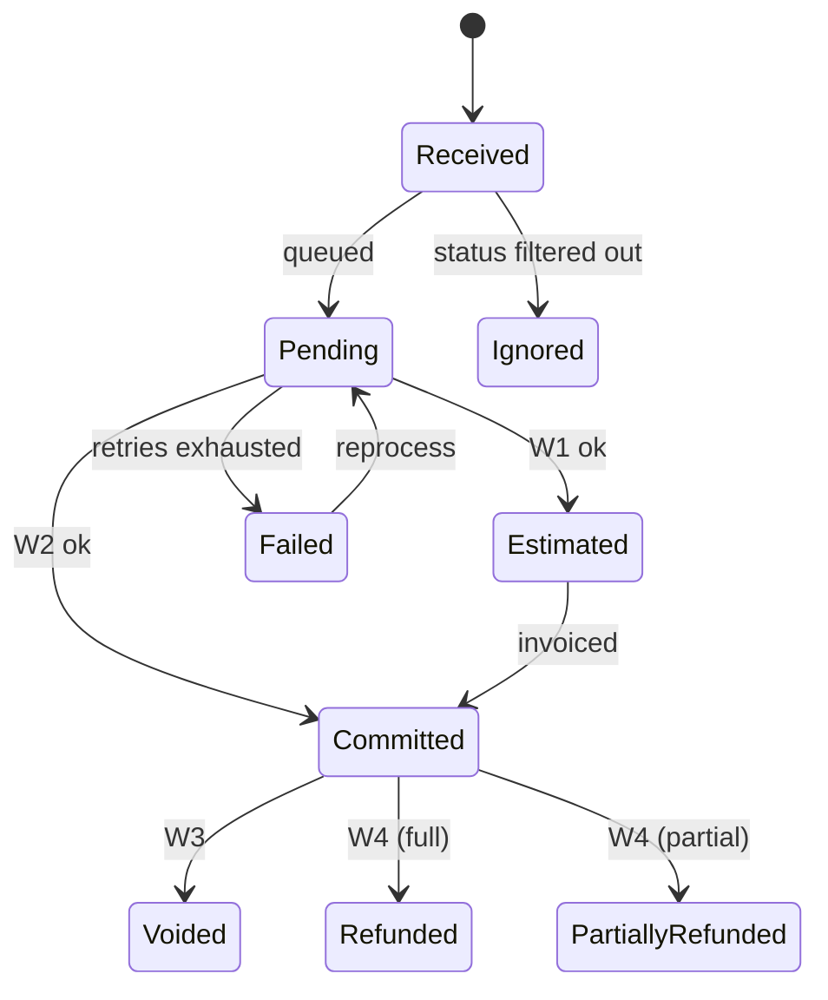

# 01 — Core Workflows

**Status:** Draft v0.1 · **Date:** 2026-11-21 · **Owner:** TSG

This document covers *how requests flow*. It doesn't cover data models, UI or infrastructure; those have their own documents.

---

## 1. Actors

| Actor | Description |
|---|---|
| **Source system** | ERP, finance or eCommerce app (MYOB Acumatica, Cin7 Core/Omni, Unleashed, Shopify, ...). Creates orders and invoices. Usually has no tax engine of its own. |
| **Source connector** | Gateway component that talks to one source system type: receives or pulls documents and writes results back. |
| **Gateway core** | Provider-neutral logic: normalise, decide, route, store, return. |
| **Provider adapter** | Gateway component that talks to one tax provider (Avalara, Zamp, Taxually, ...). |
| **Tax provider** | External tax calculator. Calculates tax, records committed transactions, and in some cases files returns. |
| **TSG admin** | Configures tenants, connectors and providers. |
| **Tenant user** | Merchant staff using the portal (reports, search, provider choice?). See Q-20. |

## 2. Big picture

The **gateway core** never contains source-specific or provider-specific code. It only speaks the **canonical model**.

## 3. How requests arrive (trigger modes)

Most finance systems can't call out to a tax engine on their own, so the gateway has to support more than one way of getting requests in. Which modes each source supports is in Q-10 to Q-12.

| Mode | How it works | Tax in ERP before posting? | Example |
|---|---|---|---|
| **A. Real-time call** | An ERP customisation (button, save event) calls the gateway API and waits for the answer. | Yes | MYOB Acumatica "Calculate Tax" button |
| **B. Event push** | The ERP sends a webhook on create/update. The gateway calculates and writes tax back through the ERP API. | Yes (a few seconds later) | Shopify, Cin7 webhooks |
| **C. Scheduled pull** | The gateway polls the ERP for new or changed documents, calculates, and writes back. | Depends on the polling interval | Systems with no webhooks |

> **REQ-WF-1** Every connector declares which modes it supports. A tenant's connector is configured to one or more of them.

## 4. Generic request pipeline

Every action (calculate, commit, void, ...) goes through the same pipeline:

> **REQ-WF-2** Every inbound payload is stored raw before it's processed.
> **REQ-WF-3** Every outbound provider call is logged with its request, response, duration and outcome.
> **REQ-WF-4** Each action is idempotent on the key (TenantId, SourceSystem, DocumentId, DocumentVersion, Action).
> **REQ-WF-5** Provider calls retry with backoff. If it still fails, the transaction is marked *Failed* and shows up in the portal for reprocessing.
> **REQ-WF-9** **Parallel calculation:** after the primary engine's result is returned, the same canonical request is queued to the challenger engines (TSG cache, TSG rules, an optional second provider). All results are stored and compared. See [09-roadmap.md](09-roadmap.md).

## 5. Workflows

### W1 — Calculate tax (estimate)
**When:** a quote or sales order is created or changed.
**What:** returns tax per line and in total. **Nothing is recorded with the provider** (uncommitted / estimate).
**Inputs:** ship-from (warehouse), ship-to, customer (and exemption), lines (item, tax code, quantity, amount, discount), freight, currency, date.
**Output:** tax per line, tax by jurisdiction, total tax. Optionally the validated address.

### W2 — Commit tax (invoice)
**When:** an invoice is finalised/released.
**What:** recalculates tax and records a **committed** transaction with the provider (the provider uses it for reporting and filing).
**Rule:** if the invoice tax differs from the order estimate, the invoice wins. Flag the difference? See Q-31.

### W3 — Void / cancel
**When:** an invoice is voided or cancelled in the ERP.
**What:** voids the committed transaction with the provider that committed it.

### W4 — Refund / credit note
**When:** a credit note or return is created against an invoice.
**What:** creates a refund/return transaction with the provider (full or partial lines).

### W5 — Address validation
**When:** on demand (a button on the customer record) and/or automatically as part of W1/W2.
**What:** validates and standardises the ship-to address. Can write the corrected address back to the ERP.
**Provider:** can differ from the tax provider (REQ-WF-8).

### W6 — Exemption check
**When:** when a customer is created or changed, and/or at W1/W2.
**What:** asks the provider whether the customer is exempt (for ship-to state / entity use). Can write the exempt flag back to the ERP. The gateway **doesn't store certificates**, only status and reference.

### W7 — Master data sync
**What:** keeps customers, items→tax code mapping and warehouses (ship-from) in step between the ERP and the gateway, and the provider if needed.
**Why:** W1/W2 can't calculate correctly without a tax code per item and a ship-from address.

### W8 — Switch tax provider
**Who:** TSG admin (or tenant admin? see Q-21).
**What:** changes a tenant's active provider. No ERP change needed.

> **REQ-WF-6** Every stored transaction records which provider (and provider account) produced it.
> **REQ-WF-7** Voids and refunds are always sent to the provider that committed the original transaction, even after a switch.
> **REQ-WF-8** The provider for each capability can be chosen separately: tax calculation, address validation and exemption.

### W9 — Tax rate cache to cut cost (roadmap, not MVP)

> The cache is one of the engines in parallel calculation ([09-roadmap.md](09-roadmap.md)). It runs as a **challenger** until the evidence makes it eligible to be primary for a scope. The verification sampling below still applies once it's primary.
**Idea:** tax rates for a given product and destination rarely change. If a request matches a rate we already got from the provider, and that cached rate is still valid, **apply the cached rate instead of paying for a provider call**.

**Principle:** the cache can be wrong at any time. Because of that, it's **fully configurable, can be switched off at any level, always expires, and every result says whether it came from the cache or the provider.**

#### W9.1 Cache key

The cache stores **jurisdiction rates**, not tax amounts. The amount is recalculated for each request from the cached rates.

| Key part | Notes |
|---|---|
| TenantId | Cache is per tenant by default (sharing across tenants: Q-42) |
| Provider + provider account | Rates from Avalara are never reused for Zamp |
| Product tax code | Not the SKU. Many SKUs share one tax code. |
| Ship-from jurisdiction | Origin-based states need it |
| Ship-to **destination** | Country → state → county → city → postal code (ZIP+4 / rooftop for US). See W9.3. |
| Customer exemption status / entity use code | An exempt customer never gets a taxable cached rate |
| Tax date | Must fall inside the entry's validity window |

#### W9.2 Configuration levels

The settings are on/off, expiry (TTL), and which actions may use the cache. **The most specific level wins.** Any level can set `enabled = false`, and that overrides everything below it.

| Setting | Global | Tenant | Destination | Product tax code |
|---|---|---|---|---|
| `enabled` | ✅ kill switch | ✅ | ✅ | ✅ |
| `ttl` (e.g. 30 days) | ✅ default | ✅ | ✅ | — |
| `expireOnRateChangeDates` (e.g. 1 Jan / 1 Apr / 1 Jul / 1 Oct) | ✅ default | ✅ | ✅ | — |
| `allowedActions` (W1 estimate / W2 commit) | ✅ | ✅ | — | — |
| `verificationSampleRate` (W9.5) | ✅ | ✅ | ✅ | — |

Example: a tenant turns the cache **on** with a 90-day TTL, **off** for California (frequent local district changes), and sets a 7-day TTL for Colorado home-rule cities.

> **REQ-CACHE-1** The cache is off by default. It's enabled explicitly at tenant level.
> **REQ-CACHE-2** Settings can be configured at the global, tenant, destination and product tax code levels. The most specific level wins, and `enabled = false` at a higher level always wins.
> **REQ-CACHE-3** Every cache entry has an expiry. An entry with no TTL can't be stored.
> **REQ-CACHE-4** An entry expires at the **earliest** of its TTL, the next configured rate-change date, or a manual purge.
> **REQ-CACHE-5** Config changes take effect immediately. Turning a level off doesn't need a deploy or restart.
> **REQ-CACHE-6** By default only W1 (estimate) uses the cache. W2 (commit) is always sent to the provider unless the tenant explicitly allows the cache for commits **and** the provider isn't filing their returns (Q-41).

#### W9.3 Destination levels

"Destination" can be configured at any of these levels. A more specific setting wins:

`Country` → `State/Region` → `County` → `City` → `Postal code`

The **lookup** always matches at full precision (the jurisdictions returned by the provider, or the rooftop/ZIP+4 address). In the US one 5-digit ZIP can span several tax rates, so we never treat a match on a 5-digit ZIP alone as a hit.

#### W9.4 Flow

- **All lines or nothing:** if any line misses the cache, call the provider for the whole document. We never mix cached and live rates in one document.
- **Amount-dependent rules:** product tax codes with thresholds, caps or per-unit taxes (e.g. clothing under a price limit, single-item caps) can't be calculated from a rate. They're excluded through the product tax code level.

#### W9.5 Safety nets

> **REQ-CACHE-7** Every stored tax result records `source = PROVIDER | CACHE`, the cache entry ID and the entry's original provider response time.
> **REQ-CACHE-8** **Verification sampling:** a configurable % of cache hits are also sent to the provider and compared. A mismatch purges the entry, raises an alert, and (configurable) switches the cache off for that destination.
> **REQ-CACHE-9** **Manual purge:** TSG admins and tenant admins can purge by tenant, destination or product tax code from the portal.
> **REQ-CACHE-10** The entire cache for a tenant is purged when the tenant switches provider (W8) or provider account.
> **REQ-CACHE-11** The portal reports cache hit rate, provider calls saved and verification mismatches per tenant and destination.

> **REQ-CACHE-12** Cache settings are managed only through the dedicated cache screens (client and admin). Any active **Tax Change Event** forces live calculation for its scope. See [02-configuration.md](02-configuration.md) §7–8.

**Still to confirm:** Q-40 to Q-48.

## 6. Transaction states

## 7. Not in this document
- Configuration, onboarding and cache UI → [02-configuration.md](02-configuration.md)
- Canonical field list → 03-domain-model.md
- Connector mapping engine → 04-connectors.md
- Provider adapter interface → 05-providers.md
- Portal screens and reports → 07-portal-reporting.md
