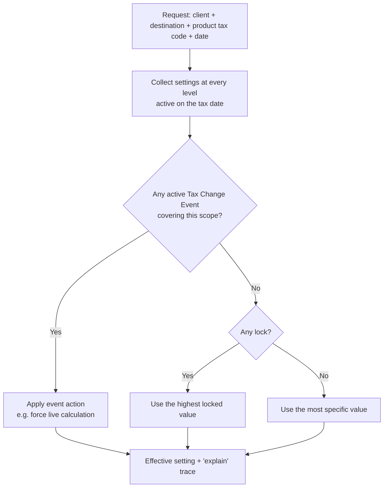
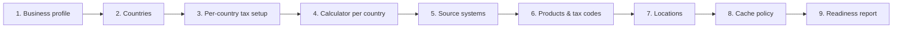
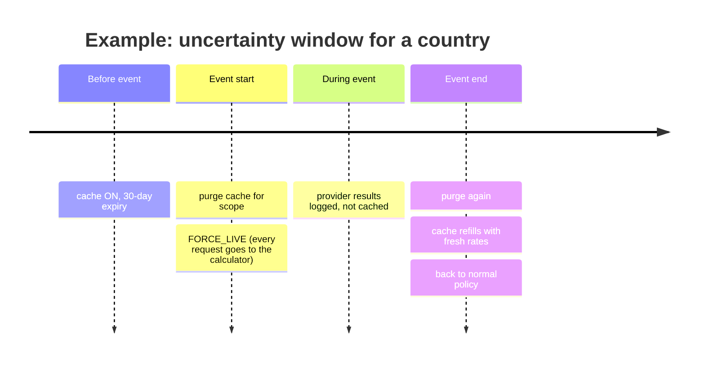

# 02 — Configuration

**Status:** Draft v0.1 · **Date:** 2026-11-21 · **Owner:** TSG

Configuration is the product's main advantage. One gateway, set up per client and per country, means:
- the right calculator for each country,
- safe cost savings through caching,
- a fast reaction when tax law changes,

all without code changes or ERP changes.

This document covers **what can be configured, by whom, at what level, and through which screens.**

---

## 1. Principles

> **REQ-CFG-1 — Everything through the UI.** All business configuration is done in dedicated screens. No config files, no direct database edits, no deploys.
> **REQ-CFG-2 — One hierarchy.** Settings resolve as `Global → Client → Country → Region (state/province) → Locality (county/city/postal) → Product tax code`. The most specific level wins. A higher-level **lock** or **off** always wins (see §3).
> **REQ-CFG-3 — Effective dating.** Every setting has `effectiveFrom` and an optional `effectiveTo`. Changes can be scheduled ahead (e.g. switch provider on 1 Jan).
> **REQ-CFG-4 — Audit and rollback.** Every change records who, when, old value, new value and a reason. Any previous version can be restored in one click.
> **REQ-CFG-5 — Explain.** For any client + destination + product tax code, the UI shows the **effective** setting and *which level it came from*.
> **REQ-CFG-6 — Safe by default.** New clients start with the cache off, live calculation, and providers only where they are certified for the country.
> **REQ-CFG-7 — Instant effect.** Saved changes take effect for the next request (within a few seconds), with no restart.

## 2. Who configures what

| Area | TSG admin | Client admin | Client user |
|---|---|---|---|
| Provider catalogue & capability matrix (§5) | Edit | View | — |
| Global defaults & kill switches | Edit | — | — |
| Client onboarding / country setup (§4) | Edit | Edit (if self-service, Q-25) | View |
| Provider per country & capability (§6) | Edit | Edit or request (Q-21) | View |
| Provider credentials | Edit | Edit | — |
| Connector setup & document/status mapping | Edit | View | — |
| Product tax code mapping | Edit | Edit | View |
| Cache policy (§7) | Edit + **lock** | Edit within locks | View |
| Tax change events (§8) | Create global/any client | Create for own client | View |
| Cache purge | Any client | Own client | — |
| Value & savings dashboard (§9) | All clients | Own client | Own client |
| Audit log | All | Own client | — |

**Locks:** a TSG admin can lock any setting at any level, for example *"cache must stay OFF for Brazil for all clients"*. A locked setting shows a padlock and the reason in the client UI, and can't be overridden below that level.

## 3. Resolution rules



Priority (highest first):
1. **Global kill switch**
2. **Active tax change event** (§8)
3. **Lock** (the highest level wins)
4. **Most specific level** (Product tax code → Locality → Region → Country → Client → Global)

## 4. Client onboarding — country-based setup

Clients are set up **by country**, because each country has a different tax type, rules and suitable calculators. The onboarding wizard:



| Step | Captured | Improvements this enables |
|---|---|---|
| 1. Business profile | Legal name, home country, base currency, industry, B2B/B2C mix, marketplace seller? | Suggests typical exemptions (B2B resale) and marketplace facilitator rules |
| 2. Countries | Countries the client **ships to** and the countries where it is **registered** (nexus / VAT / GST) | Calculates only where registered. Elsewhere returns zero tax with the reason "not registered". |
| 3. Per-country tax setup | Tax type (Sales & Use, VAT, GST, IOSS/OSS), registration numbers, states/provinces with nexus, filing frequency, prices tax-inclusive or exclusive | Correct calculation mode per country. Warns about missing registrations. |
| 4. Calculator per country | Provider for each capability (calculate, address validation, exemption, filing) chosen from providers **certified for that country** (§5) | Stops a client using a calculator that was never designed for that country |
| 5. Source systems | ERP/eCommerce connectors, trigger mode, document types, status mapping | — |
| 6. Products & tax codes | SKU/category → product tax code mapping, import from CSV | Flags unmapped products before go-live |
| 7. Locations | Warehouses / ship-from addresses with address validation | Correct origin-based calculation |
| 8. Cache policy | Start from a country template (§7.3), or leave off | Savings estimate shown before it's enabled |
| 9. Readiness report | Green/amber/red per country: provider certified, registrations, tax codes mapped, test calculation passed | Go-live checklist and a sales asset |

> **REQ-CFG-8** A client can't go live in a country until its readiness check is green or a TSG admin has signed off amber items.
> **REQ-CFG-9** Adding a country later runs steps 3–4 and 8–9 for that country only.
> **REQ-CFG-10** The wizard runs a **test calculation** per country against the chosen provider's sandbox before go-live.

## 5. Provider catalogue & capability matrix (TSG maintained)

A TSG-maintained table of **which provider supports which country and capability**. It drives the onboarding choices and the routing.

| Provider | Country/region | Calculate | Address validation | Exemption | Filing | IOSS/OSS | Duties/landed cost | Certified by TSG |
|---|---|---|---|---|---|---|---|---|
| Avalara | US | ✅ | ✅ | ✅ | ✅ | — | ✅ | ✅ |
| Zamp | US | ✅ | ✅ | ✅ | ✅ | — | — | ✅ |
| Taxually | UK / EU | ✅ VAT | — | — | ✅ | ✅ | — | ☐ |
| ... | | | | | | | | |

*(Values are illustrative and must be verified per provider.)*

> **REQ-CFG-11** A provider can only be assigned to a client + country + capability where the matrix says it's supported **and** TSG-certified. TSG admins can override this with a recorded reason.
> **REQ-CFG-12** If the matrix changes (a provider drops a country), affected clients are listed and alerted.
> **REQ-CFG-13** The matrix records **indicative cost per call** for each provider, so savings (§9) and provider comparisons can be shown.

## 6. Provider routing per country

A client can use different calculators in different countries, and a different provider for each capability:

| Client: Acme Pty Ltd | Calculate | Address validation | Exemption | Effective from |
|---|---|---|---|---|
| United States | Zamp | Avalara | Zamp | 2026-12-01 |
| United Kingdom | Taxually | — | — | 2027-01-01 |
| Australia | *Internal GST rule (10%)?* see Q-63 | — | — | |

Switching a provider is a scheduled, effective-dated change. The switch rules are in 01-workflow W8.

## 7. Cache configuration

### 7.1 Settings

| Setting | Levels | Description |
|---|---|---|
| `enabled` | All | On/off |
| `ttlDays` | Global → Locality | How long an entry stays valid |
| `maxTtlDays` | Global, Client (TSG only) | Upper limit clients can't exceed |
| `expireOnDates` | Global → Region | Fixed dates when entries are cleared (e.g. 01-01, 04-01, 07-01, 10-01) |
| `allowedActions` | Global, Client | `ESTIMATE` and optionally `COMMIT` |
| `verifySamplePct` | Global → Region | % of cache hits also checked against the provider |
| `autoDisableOnMismatch` | Global → Region | Switch the cache off for the destination on a mismatch |
| `lock` | All (TSG only) | Prevents overrides below this level |

### 7.2 Screens

**Client screen — "Tax Cache"**
```
┌ Tax Cache ─────────────────────────────── Client: Acme Pty Ltd ┐
│ Cache: [ON]   Default expiry: [30] days   Verify: [5]%         │
│ Savings this month: 12,430 calls avoided · est. $1,864         │
├────────────────────────────────────────────────────────────────┤
│ Destination        Status   Expiry  Source         Hit rate    │
│ United States      ON       30d     Client         81%         │
│  ├ California      OFF 🔒   —       TSG lock       —           │
│  ├ Colorado        ON       7d      Client         64%         │
│  └ Texas           ON       30d     inherited      88%         │
│ United Kingdom     OFF      —       Tax event ⚠    —           │
├────────────────────────────────────────────────────────────────┤
│ [+ Add destination rule] [Purge cache] [Explain…] [History]    │
└────────────────────────────────────────────────────────────────┘
```

**Admin screen — "Cache Control (all clients)"**
- Global kill switch and global defaults.
- A grid of clients × countries showing cache status, hit rate, mismatches and savings.
- Lock or unlock any level, with a reason.
- Mismatch feed: the latest verification failures, with one click to purge or disable.
- Bulk actions: apply a template to many clients, purge by country across all clients.

**Explain dialog** (both roles): enter a destination + product tax code → shows the effective settings, the level each came from, the active events and locks, and the current cache entry if any.

### 7.3 Country templates

TSG ships cache templates per country, for example:
- **US:** 30 days, expire on quarter starts, verify 5%, states with frequent local changes set to 7 days.
- **UK:** 90 days, expire on 1 Apr.
- **New country:** cache off until there's enough provider data.

A client applies a template and then adjusts it within locks.

## 8. Tax change events

When tax law changes, or might change, the gateway must **stop trusting the cache and use the calculator.** A **Tax Change Event** forces live calculation for a scope and period.

| Field | Description |
|---|---|
| Name / reason | e.g. "US tariff changes 2026", "UK VAT rate change" |
| Scope | Global or a client · country · region · locality · product tax codes (optional) |
| Type | **Planned** (a known future date) or **Uncertainty** (unclear when or what) |
| Period | Start date/time → end date/time (or open-ended, reviewed later) |
| Action | `FORCE_LIVE` (bypass the cache), `PURGE_ON_START`, `PURGE_ON_END` |
| Notify | Affected clients (banner + email) |
| Created by | TSG admin (any scope) or client admin (own client only) |



> **REQ-CFG-14** While an event is active for a scope, **no cache reads or writes** happen in that scope. Every request goes to the calculator.
> **REQ-CFG-15** Events can be scheduled ahead (planned rate changes) or started immediately (uncertainty).
> **REQ-CFG-16** An open-ended event sends a review reminder to TSG admins every N days (configurable) until it's closed.
> **REQ-CFG-17** TSG maintains a **tax change calendar** (known rate-change dates per country/region). Planned events can be created from it in one click and applied to all affected clients.
> **REQ-CFG-18** Active events are visible on the client's cache screen and dashboard with their reason.

*Note:* tariffs are customs duties rather than sales tax/VAT, and not every calculator covers them (see the "Duties/landed cost" column in §5). An uncertainty event is still the right tool: it forces fresh calculator results for the affected countries/products until things settle.

## 9. Value & savings dashboard (sales showcase)

The same data that drives configuration shows *why the client should use this product*. Client view and admin view:

| Panel | Shows |
|---|---|
| **Provider calls saved** | Cache hits × the provider's indicative cost per call (REQ-CFG-13) = estimated $ saved |
| **Accuracy** | Verification sample results: % match, mismatches caught and fixed |
| **Coverage** | Countries live, the calculator used in each, the readiness score |
| **Protection** | Tax change events applied, the number of requests forced live during uncertainty |
| **Flexibility** | Provider switches made with no ERP change, and how long each took |
| **Operational** | Transactions processed, failed/retried, address corrections made |

> **REQ-CFG-19** At onboarding, show a **projected savings estimate** from the client's expected volume, destinations and country templates.
> **REQ-CFG-20** TSG admins can export a client's value report (PDF) for account reviews and sales.

## 10. Calculation mode (Live / Improved)

Each client chooses a **calculation mode per country**. It's agreed at the point of sale and can be changed at any time. Parallel calculation and the evidence model are in [09-roadmap.md](09-roadmap.md).

| Setting | Levels | Values |
|---|---|---|
| `calculationMode` | Client → Country → Region | `LIVE` (external provider is always primary) · `IMPROVED` (the approved, proven engine is primary for that scope) |
| `allowedPrimaryEngines` | Client → Country (TSG lock possible) | Which engines may ever be primary, e.g. `PROVIDER, CACHE` but never `TSG_RULES` |
| `challengers` | Global → Client → Country | Which engines run in the background. Free engines are always on. Paid second provider + sample %. |
| `matchTolerance` | Global → Country | $ and % tolerance for comparison |
| `primaryEligibility` | Global → Country (**TSG only**) | Confidence lower bound, minimum sample size, minimum days, quiet period |
| `primaryAssignment` | Country → Region → Locality × product tax code (**TSG approves**) | The engine currently primary, set only through the promotion board |

The effective primary for a request is the external provider if any of these hold: the mode is `LIVE`, the assigned engine isn't in `allowedPrimaryEngines`, its confidence has dropped below eligibility, or a Tax Change Event is active.

**Screens:**
- **Client:** per country, a Live / Improved toggle, the current primary per region, and the evidence (engines compared, match rate, confidence, potential savings).
- **Admin:** promotion board listing scopes × engines × confidence × sample size × recommendation, with Approve / Reject (reason required). Also the mismatch triage and engine comparison screens ([09-roadmap.md](09-roadmap.md) §6).

## 11. Configuration entities (outline)

Details in 03-domain-model.md.

| Entity | Key fields |
|---|---|
| `ProviderCapability` | ProviderId, Country, Capability, Certified, CostPerCall |
| `ClientCountry` | TenantId, Country, Registered, TaxType, RegistrationNos, PricesIncludeTax, ReadinessStatus |
| `ProviderRoute` | TenantId, Country, Capability, ProviderAccountId, EffectiveFrom/To |
| `CachePolicy` | Scope (level + key), Settings, Locked, LockReason, EffectiveFrom/To |
| `TaxChangeEvent` | Scope, Type, Start, End, Actions, Reason, CreatedBy |
| `TaxCalendarEntry` | Country, Region, Date, Description |
| `ConfigAudit` | Entity, EntityId, OldValue, NewValue, ChangedBy, ChangedAt, Reason |
| `ClientCalcMode` | TenantId, Scope, Mode (LIVE/IMPROVED), AllowedPrimaryEngines, Challengers, EffectiveFrom/To |
| `PrimaryAssignment` | see [09-roadmap.md](09-roadmap.md) §7 |
