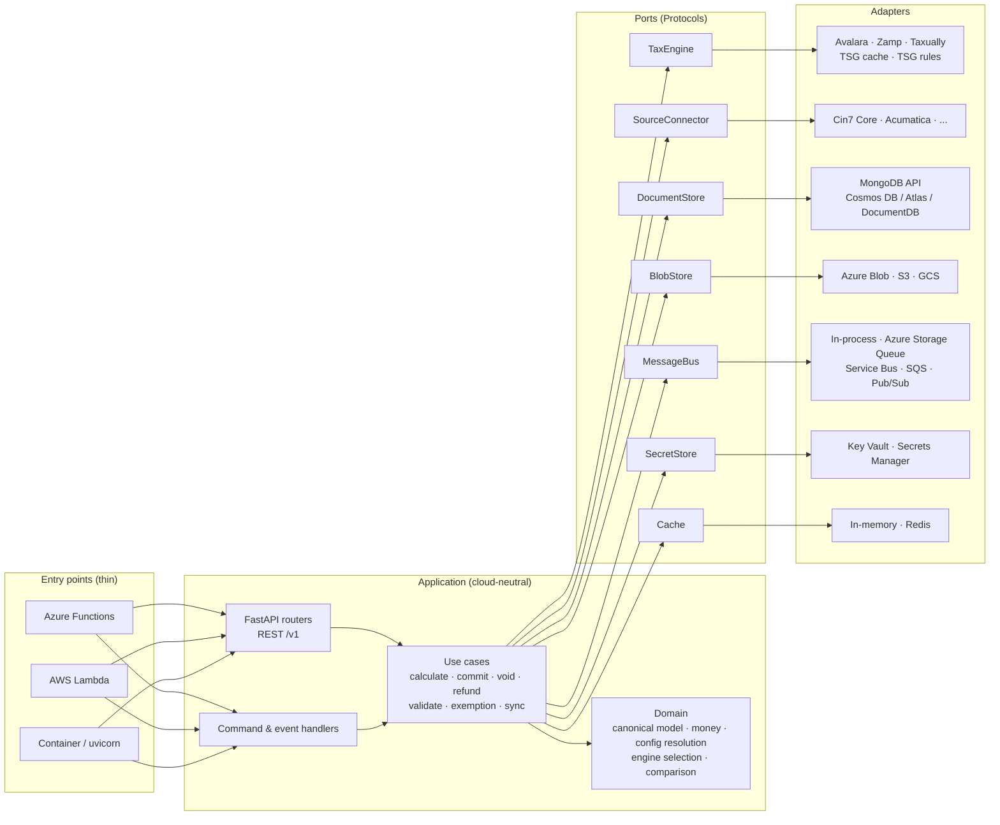
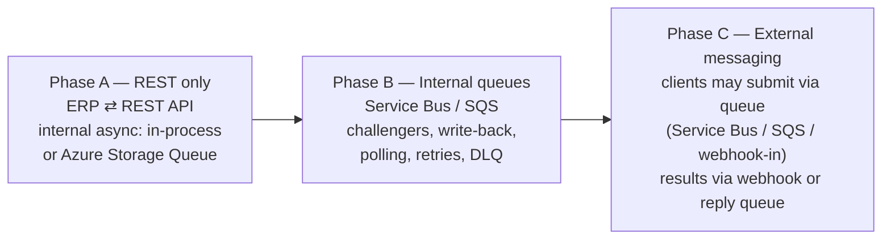

# 08 — Architecture

**Status:** Draft v0.3 · **Date:** 2026-11-22 · **Owner:** TSG

This document is **architecture guidance**: how Taxcart is built, how it runs cheaply at the start, and how it grows. Decisions marked **ADR-n** need sign-off.

> **v0.3 (answers Q-06, Q-18, Q-20, Q-24, Q-30, Q-35):** the MVP is US only, Cin7 Omni → Zamp, at about 40–50 orders a day per client. That fits stage S0 easily. The MVP needs background jobs from day 1 (§6.2), not only REST. Roles and MFA are updated in §9.

**Direction (from TSG):**
- **Python** backend, following best practices (§10).
- **Cheap first:** serverless (Azure Functions / AWS Lambda) that scales up as volume grows.
- **Azure first**, other clouds later. The roadmap must keep those options open.
- **Document database**, not an RDBMS.
- **REST first.** Message queues are added later without a rewrite.
- **React + TypeScript** UI.

---

## 1. Architecture principles

| # | Principle | What it means in practice |
|---|---|---|
| P1 | **Cloud-neutral core** | Business logic never imports a cloud SDK. Cloud services are reached through **ports** (Python `Protocol`s) with one adapter per cloud. |
| P2 | **One app, many hosts** | The same FastAPI app and the same message handlers run on Azure Functions, AWS Lambda or a container. Only a thin entry point differs. |
| P3 | **Pay per use first** | Prefer scale-to-zero, free tiers and per-request pricing until volume justifies always-on resources. |
| P4 | **Message-shaped from day 1** | Every action is a typed **command** or **event**, even when delivered over REST, so adding a queue later is a transport change, not a redesign. |
| P5 | **Provider/source neutral** | No Avalara- or Cin7-specific code outside their adapters (the original spec's principle). |
| P6 | **Tenant-safe by construction** | Every document carries `tenantId`. The repository layer adds the tenant filter automatically and can't be bypassed. |
| P7 | **Everything recorded** | Raw payloads, every engine result and every external call are stored (REQ-WF-2/3, REQ-PAR-4). |
| P8 | **Money is `Decimal`** | Never `float`, anywhere: API, domain or storage. |

## 2. Hexagonal architecture (ports & adapters)



**Rule:** `domain` and `application` import only `ports`. Adapters are wired in a single **composition root** per entry point, chosen by configuration (`CLOUD=azure|aws|local`). These boundaries are enforced automatically with `import-linter` in CI.

## 3. Technology stack

| Layer | Choice | Why |
|---|---|---|
| Language | **Python 3.13** (move to 3.14 when all hosts support it) | Supported by Azure Functions, AWS Lambda and containers |
| Web framework | **FastAPI** + **Pydantic v2** | Typed, async, generates OpenAPI (used for the TS client) |
| Azure host | Azure Functions **Flex Consumption** via `AsgiFunctionApp` (HTTP) + queue/timer triggers | Scale to zero, pay per execution, optional always-ready instances |
| AWS host (later) | Lambda + API Gateway HTTP API via **Mangum** (HTTP), SQS/EventBridge triggers | Same app |
| Container host (scale) | uvicorn/gunicorn in Docker → Azure Container Apps / AWS ECS Fargate / Google Cloud Run | Cheaper than functions at steady high volume |
| HTTP client | **httpx** (async, shared client, connection pooling) | Provider and ERP calls |
| Database | **Document DB via the MongoDB API** (ADR-3) | One driver on every cloud |
| DB driver | **PyMongo async** (`AsyncMongoClient`) | Motor is deprecated in favour of PyMongo's async API |
| Object storage | Azure Blob → S3 / GCS (via the `BlobStore` port) | Raw payloads, exports |
| Messaging | Phase-based (§6): in-process → Azure Storage Queue → Service Bus / SQS | Cheap first |
| Cache | In-memory TTL + TTL documents in the DB → Redis later | No fixed Redis cost at the start |
| Secrets | Azure Key Vault → AWS Secrets Manager (via the `SecretStore` port) | |
| Identity (portal) | Any **OIDC** provider. Start with **Microsoft Entra External ID** (ADR-4). | The backend only validates standard JWTs, so the identity provider can be swapped |
| Frontend | **React + TypeScript**, Vite | §8 |
| IaC | **Terraform / OpenTofu** (ADR-8) | One tool for Azure, AWS and GCP |
| CI/CD | GitHub Actions, OIDC federation to each cloud | No stored cloud secrets |
| Observability | **OpenTelemetry** → Azure Monitor / CloudWatch / Grafana | Cloud-neutral instrumentation |

## 4. Repository structure

```
TaxCalculator/
  spec/                         # this specification
  backend/
    pyproject.toml              # uv-managed, single source of tool config
    uv.lock
    src/tsg_gateway/
      domain/                   # pure Python: no I/O, no cloud, no HTTP
        money.py                # Decimal, currency, rounding
        canonical/              # TaxRequest, TaxResult, Transaction, Line, Address...
        configuration/          # hierarchy resolution, locks, explain, tax events
        selection/              # primary/challenger engine selection
        comparison/             # result diffing, confidence scoring
        errors.py               # domain exception hierarchy
      application/              # use cases + command/event handlers
        commands.py             # CalculateTax, CommitTax, VoidTax, RefundTax...
        events.py               # TaxCalculated, TaxCommitted, ComparisonCompleted...
        handlers/
      ports/                    # typing.Protocol interfaces
        tax_engine.py  source_connector.py  document_store.py
        blob_store.py  message_bus.py  secret_store.py  cache.py  clock.py
      adapters/
        engines/{avalara,zamp,taxually,tsg_cache,tsg_rules}/
        connectors/{cin7_core,acumatica}/
        persistence/mongo/      # repositories, indexes, tenant filter
        storage/{azure_blob,s3,local}/
        messaging/{inprocess,azure_storage_queue,azure_service_bus,sqs}/
        secrets/{azure_keyvault,aws_secrets,env}/
        cache/{memory,redis}/
      entrypoints/
        api/                    # FastAPI app factory, routers, auth, problem details
        azure_functions/function_app.py
        aws_lambda/handler.py
        container/main.py
      bootstrap.py              # composition root: picks adapters from settings
      settings.py               # pydantic-settings
    tests/
      unit/  contract/  integration/  e2e/
  web/portal/                   # React + TypeScript SPA
  tools/                        # local-only, never deployed (10-local-development.md)
    dev-idp/  provider-sim/  erp-sim/  api-collection/
  docker-compose.yml            # MongoDB only (+ 'full' profile for demos)
  Makefile                      # setup · dev · seed · test · check
  infra/terraform/
    modules/                    # cloud-neutral module interfaces
    azure/  aws/                # per-cloud implementations
    envs/{dev,test,prod}/
  .github/workflows/
```

### 4.1 Port example

```python
from typing import Protocol
from tsg_gateway.domain.canonical import TaxRequest, TaxResult, EngineContext

class TaxEngine(Protocol):
    engine_id: str

    async def calculate(self, request: TaxRequest, ctx: EngineContext) -> TaxResult: ...
    async def commit(self, request: TaxRequest, ctx: EngineContext) -> TaxResult: ...
    async def void(self, document_id: str, ctx: EngineContext) -> None: ...
    async def refund(self, request: TaxRequest, ctx: EngineContext) -> TaxResult: ...
```

Engines and connectors are registered by ID in an **adapter registry**. Configuration (`ProviderRoute`, `PrimaryAssignment`) picks one at runtime, so switching provider never needs a deploy.

## 5. Data architecture: document database

### 5.1 Why a document DB fits

| Gateway data | Shape | Fit |
|---|---|---|
| Transactions (order/invoice with lines, addresses, results) | One aggregate, read and written together | ✅ One document |
| Raw payloads, provider responses | Arbitrary JSON | ✅ (large ones go in Blob) |
| Configuration at many levels | Hierarchical, schema evolves | ✅ |
| Calculation runs & comparisons | Append-only, high volume | ✅ With TTL / archiving |
| Reports (tax by jurisdiction, liability) | Aggregations across many documents | ⚠ OK with aggregation pipelines + pre-computed summaries. Heavy analytics goes to the analytics store (§5.6). |

**Trade-offs we accept:** no joins, and limited multi-document transactions. We design around them: one document per aggregate, IDs referenced rather than joined, pre-computed summaries, and an outbox inside the same document/partition (§6.3).

### 5.2 ADR-3: MongoDB API as the database contract

We code to the **MongoDB wire protocol**, which is available on every target cloud:

| Cloud | Cheap start | At scale |
|---|---|---|
| **Azure** (first) | **Azure Cosmos DB for MongoDB** (RU-based: serverless or free tier) | Cosmos DB provisioned autoscale, or vCore |
| AWS | MongoDB Atlas (Flex/serverless tier) | Atlas dedicated, or Amazon DocumentDB |
| GCP | MongoDB Atlas | Atlas dedicated, or Firestore with MongoDB compatibility |
| Local / tests | MongoDB in Docker (Testcontainers) | — |

> **REQ-ARC-1** Only MongoDB features supported by **all** of Cosmos DB for MongoDB, DocumentDB and Atlas may be used (a compatibility list is kept in the repo). CI runs the integration tests against real MongoDB (locally and in CI). An **optional** nightly job runs the same contract suite against Cosmos DB in a dev cloud account. It's never required for developers or PRs.
> Alternative considered: Cosmos DB NoSQL API (native, slightly cheaper on Azure) → rejected, because it locks the data layer to Azure.

### 5.3 Tenant isolation: pool first, silo when needed (ADR-9)

The original spec asked for a **separate database per tenant**. On a document DB that adds a fixed cost per tenant. Proposal:

| Model | How | When |
|---|---|---|
| **Pooled** (default) | Shared collections. `tenantId` is the **partition/shard key** on every collection. A repository wrapper adds `tenantId` to every query and write. | Small/medium tenants, MVP |
| **Silo** (option) | A dedicated database (or account) per tenant, mapped in the catalog | Large tenants, contractual isolation, data residency |

The repository layer gets the right database for each tenant from the **catalog**, so moving a tenant from pooled to silo is a data migration plus a catalog update. No code changes. (Confirm: Q-88.)

> **REQ-ARC-2** Repository methods take a `TenantContext` and can't run without one. Raw driver access outside `adapters/persistence` fails the `import-linter` check.
> **REQ-ARC-3** Automated tests prove that tenant A can't read tenant B's data, for every repository.

### 5.4 Collections

| Database | Collection | Partition key | Contents | TTL |
|---|---|---|---|---|
| `catalog` | `tenants` | `/id` | Tenant, status, plan, data location (pooled/silo), region | — |
| | `users` | `/tenantId` | Portal users, roles (identity lives in the OIDC provider) | — |
| | `global_config` | `/scope` | Global defaults, locks, kill switches | — |
| | `provider_catalog` | `/providerId` | Capability matrix, cost per call | — |
| | `tax_calendar` | `/country` | Known rate-change dates | — |
| | `tax_events` | `/scope` | Global Tax Change Events | — |
| | `tsg_rules` | `/country` | TSG rules engine rates/rules (versioned) | — |
| `tenant` (pooled or silo) | `tenant_config` | `/tenantId` | Countries, routes, cache policy, calc mode, connectors | — |
| | `master_data` | `/tenantId` | Items → expected tax codes, locations (`type` field) | — |
| | `customers` | `/tenantId` | Customer & address store (01-workflow, "Every document: three checks"): customer code, tax ID, exemption status, certificate reference and expiry, validated addresses with jurisdictions, `lastCheckedAt`, `nextCheckAt` | — |
| | `transactions` | `/tenantId` | Canonical document + lines + primary result + status + **outbox** array | Archive after N years |
| | `calculation_runs` | `/tenantId` | Every engine run (primary + challengers) with summary. Full payload in Blob. | e.g. 90 days → analytics store |
| | `comparisons` | `/tenantId` | Diffs, pattern key, triage label | e.g. 90 days → analytics store |
| | `confidence` | `/tenantId` | Engine × scope aggregates | — |
| | `cache_entries` | `/tenantId` | Cached jurisdiction rates | **Native TTL = expiry** |
| | `idempotency` | `/tenantId` | Idempotency key → stored response | 24–72 h |
| | `api_calls` | `/tenantId` | External call log (pointer to Blob) | e.g. 90 days → archive |
| | `audit` | `/tenantId` | Config and admin audit trail | Long retention |
| | `usage_events` | `/tenantId` | Request + engine call usage events (11-usage-metering.md) | e.g. 13 months → archive |
| | `usage_counters` | `/tenantId` | Pre-aggregated usage per day × action × engine × role × outcome × country | Long term |

**Document conventions:** `_id` is a ULID (sortable). Fields: `tenantId`, `schemaVersion`, `createdAt`/`updatedAt` (UTC ISO-8601), `etag` for optimistic concurrency. Money is stored as a **string decimal** plus an ISO currency code (e.g. `{"amount": "26.89", "currency": "USD"}`), never as a float.

### 5.5 Schema evolution

- Every document has `schemaVersion`. Pydantic models read old versions and **upgrade on read**. A background job rewrites documents lazily.
- Index definitions are code (`adapters/persistence/mongo/indexes.py`), applied idempotently at deploy time.

### 5.6 Reporting & analytics

| Need | Approach |
|---|---|
| Portal lists, search, operational counts | Indexed queries + aggregation pipelines |
| Dashboards (liability by state, savings, confidence) | **Pre-computed summary documents**, updated by event handlers |
| Heavy analytics, history, engine comparison at volume | Phase 2+: export (change feed / scheduled job) to **Parquet in Blob/S3**, queried with **DuckDB** (cheap, runs in a function) or a serverless SQL engine later |

### 5.7 Large payloads → Blob

Raw ERP payloads and provider request/response bodies are stored in Blob (`{tenantId}/{yyyy}/{mm}/{dd}/{docId}/{version}.json.gz`) with an immutability policy. Documents keep only the pointer and a hash. This keeps DB cost down (RU and storage) and makes the payloads tamper-evident.

## 6. Communication: REST now, queues later

### 6.1 One message model for every transport

Every operation is defined once as a **command** (do something) or **event** (something happened). The format is the **CloudEvents** envelope with a Pydantic payload:

```json
{
  "specversion": "1.0",
  "type": "tsg.tax.calculate.v1",
  "source": "connector/cin7core/acme-01",
  "id": "01JD8Z...",
  "time": "2026-11-21T10:15:00Z",
  "tenantid": "acme",
  "correlationid": "8c1f...",
  "idempotencykey": "SO-007033-v3-calculate",
  "data": { "...": "canonical TaxRequest" }
}
```

The REST body for `POST /v1/tax/calculate` is the same `data` payload. A message on a queue is the full envelope. **Handlers don't know which transport delivered the message.**

### 6.2 Evolution



| Phase | Client ⇄ gateway | Inside the gateway | Cost |
|---|---|---|---|
| **A (MVP)** | REST (sync for real-time calc, `202 Accepted` + status URL for async) | `MessageBus` port. The `inprocess` adapter for local/dev. **Azure Storage Queue** for real background work (challengers, write-back), because it's near-zero cost. | Lowest |
| **B (growth)** | REST | **Azure Service Bus** (topics, sessions, dead-letter) / **AWS SQS + SNS/EventBridge** | Pay as you grow |
| **C (scale / enterprise)** | REST **and** messaging: clients can publish commands to a queue and receive results via webhook or a reply queue | Same | Per client need |

> **REQ-ARC-4** Every handler is **idempotent** (idempotency key per command), because queues deliver at least once.
> **REQ-ARC-5** Switching from Storage Queue to Service Bus or SQS is an adapter + configuration change, verified by the same contract test suite (`tests/contract/message_bus`).
> **REQ-ARC-7** Phase A includes **background jobs from the MVP**, run by a timer or Storage Queue trigger:
> - refresh the customer & address store (exemption and address checks, Q-30),
> - retry documents in *PendingRetry* when the provider was down (Q-35),
> - retry failed write-backs to the ERP,
> - poll the ERP, if Cin7 Omni has no usable webhooks (Q-106).
>
> Locally they run in-process (or with `make` targets); the same handlers run under the cloud trigger.

### 6.3 Outbox without a relational DB

When a transaction is saved, the events to publish are written **in the same document** (an `outbox` array) in one atomic write. A relay (change feed trigger, or a short timer) publishes them and marks them sent. Result: no lost events, and no events for unsaved data.

### 6.4 REST API conventions

- Versioned paths: `/v1/...`. Breaking changes → `/v2`.
- Resource style: `POST /v1/tax/calculate`, `POST /v1/tax/commit`, `POST /v1/transactions/{id}/void`, `GET /v1/transactions?...`.
- The `Idempotency-Key` header is required on all POSTs that change state.
- Errors use **RFC 9457 Problem Details** (`application/problem+json`).
- Pagination is cursor-based (`?cursor=&limit=`).
- The OpenAPI spec is generated by FastAPI, committed, and diff-checked in CI. Breaking changes fail the build.
- Every response carries `X-Correlation-Id`.

## 7. Cloud deployment & scaling roadmap

### 7.1 Stages

| Stage | Trigger | Compute | Database | Messaging | Cache | Est. monthly cost |
|---|---|---|---|---|---|---|
| **S0 MVP** | First clients (~40–50 orders/day each, Q-18) | Azure Functions **Flex Consumption** (scale to zero) | Cosmos DB for MongoDB **serverless / free tier** | Storage Queue | In-memory + TTL docs | Very low (mostly free grants) |
| **S1 Growth** | Steady daily traffic, cold starts noticed | Flex Consumption + **always-ready instances** for the Gateway API | Cosmos DB **autoscale** | **Service Bus** Standard | Optional Redis (small) | Low |
| **S2 Scale** | Sustained high volume (functions cost > containers) | **Azure Container Apps** (same image, KEDA scaling on queue length) | Cosmos autoscale / vCore, silo DBs for large tenants | Service Bus Premium if needed | Redis | Medium |
| **S3 Multi-cloud** | A client or region needs AWS/GCP, or resilience | AWS Lambda/ECS, GCP Cloud Run | Atlas / DocumentDB | SQS / Pub/Sub | ElastiCache / Memorystore | Per deployment |

> **REQ-ARC-6** Moving between stages needs **no application code changes**, only Terraform and configuration. Every stage runs the same container image / package.

Cost figures are directional. Validate them against current pricing before committing (Q-84).

### 7.2 Cloud service mapping

| Capability (port) | Azure (first) | AWS | GCP |
|---|---|---|---|
| HTTP compute (serverless) | Functions Flex Consumption | Lambda + API Gateway HTTP API | Cloud Run (scale to zero) |
| HTTP compute (containers) | Container Apps | ECS Fargate / App Runner | Cloud Run |
| Background triggers | Functions queue/timer | Lambda + SQS / EventBridge Scheduler | Cloud Run jobs + Pub/Sub / Scheduler |
| Document DB (Mongo API) | Cosmos DB for MongoDB | Atlas / DocumentDB | Atlas / Firestore (Mongo compat.) |
| Object storage | Blob Storage | S3 | Cloud Storage |
| Queue (cheap) | Storage Queue | SQS | Pub/Sub |
| Queue (rich) | Service Bus | SQS + SNS / EventBridge | Pub/Sub |
| Secrets | Key Vault | Secrets Manager | Secret Manager |
| Identity (OIDC) | Entra External ID | Cognito | Identity Platform |
| Static web hosting | Static Web Apps (free tier) | S3 + CloudFront / Amplify | Firebase Hosting |
| Edge / WAF | Front Door (S1+) | CloudFront + WAF | Cloud Armor |
| Observability | Azure Monitor / App Insights | CloudWatch / X-Ray | Cloud Monitoring |

### 7.3 Serverless-specific guidance

- **Cold starts:** keep import time low (lazy-import provider SDKs, avoid heavy libraries in the hot path). Measure cold start in CI. Use always-ready instances (S1) for the real-time Gateway API.
- **Connection reuse:** create `httpx.AsyncClient` and `AsyncMongoClient` **once per process** (module-level in the composition root), never per request.
- **Timeouts:** each function's timeout > provider timeout × retries. Never rely on work continuing after the response; background work goes through `MessageBus`.
- **Statelessness:** no local disk state. Anything shared lives in the DB, Blob or cache.

### 7.4 Environments

`local` (no cloud: one MongoDB container + local processes, filesystem blob, in-process queue, dev IdP, provider simulator; see [10-local-development.md](10-local-development.md)) → `dev` → `test` → `prod`. Staging is added at S1. Each environment is a separate resource group (prod in a separate subscription/account), created entirely by Terraform.

## 8. UI architecture (React + TypeScript)

| Concern | Choice |
|---|---|
| Build | Vite, TypeScript `strict: true` |
| UI kit | **MUI** (Material UI) + MUI X Data Grid (ADR-6): cloud-neutral, with a mature data grid for transaction-heavy screens |
| Routing | React Router (role-based route guards) |
| Server state | TanStack Query |
| Forms | React Hook Form + Zod |
| API client | Generated from the backend OpenAPI (`openapi-typescript` + `openapi-fetch`) in CI |
| Auth | `oidc-client-ts` / `react-oidc-context` (any OIDC provider; not tied to Microsoft) |
| Charts | Recharts |
| i18n | `react-i18next`, `Intl` for currency/date |
| Quality | ESLint (typescript-eslint strict), Prettier, Vitest + Testing Library, Playwright E2E |
| Hosting | Azure Static Web Apps (free tier) → S3 + CloudFront on AWS |

**Structure:** one SPA with role-based areas. Each feature folder contains its routes, components, API hooks and tests.

```
web/portal/src/
  app/         (router, layout, auth, theme)
  api/         (generated client + query hooks)
  features/    dashboard · transactions · onboarding · countries · cache ·
               tax-events · evidence · triage · connectors · products ·
               admin-clients · audit · settings
  components/  scope-picker · explain-dialog · effective-dated-editor ·
               lock-badge · audit-drawer · data-table
```

## 9. Security

| Area | Design |
|---|---|
| Portal users | OIDC (Authorization Code + PKCE). **Email + password** for the MVP (Q-24). Proposed: MFA for TSG admins anyway, since they can see every client (Q-104). MVP roles: `TsgAdmin` (TSG staff, any client), `ClientAdmin` (merchant admin, own client, read-only transactions, Q-20). A TSG consultant role is open (Q-101). `TsgAnalyst` and `ClientUser` stay defined for later. The merchant's own customers have no access. |
| ERP → Gateway | API key per connector instance (stored hashed, rotatable) or OAuth2 client credentials. Webhooks verified by HMAC + timestamp. |
| Secrets | Provider/ERP credentials in Key Vault (per-tenant naming). Read with managed identity. Cached briefly in memory. Never logged. |
| Network | HTTPS only. Private endpoints for DB/Storage/Key Vault from S1. WAF from S1. |
| Data | Encryption at rest (cloud default). PII masked in logs. Tenant filter enforced in the repository layer (REQ-ARC-2). |
| Supply chain | Locked dependencies (`uv.lock`, `package-lock.json`), Dependabot, `pip-audit`, `npm audit`, GitHub secret scanning, CodeQL. |

## 10. Python engineering standards

These are mandatory for all backend code. CI enforces them; a PR that fails any check can't be merged.

### 10.1 Tooling

| Area | Standard |
|---|---|
| Version | Python **3.13**, pinned in `pyproject.toml` (`requires-python`) and `.python-version` |
| Packaging / env | **uv**: `pyproject.toml` is the single source of truth, `uv.lock` is committed, **src layout** |
| Lint + format | **Ruff** (formatter + linter with rule sets `E,F,W,I,N,UP,B,A,C4,SIM,RUF,S,ASYNC,PT,DTZ,T20,ERA,PL`) |
| Type checking | **mypy `--strict`** (or pyright strict). No untyped defs. `Any` is banned in `domain`/`application`. |
| Architecture checks | **import-linter** contracts: domain ← application ← adapters/entrypoints. No cloud SDK imports outside adapters. |
| Pre-commit | Ruff, mypy, import-linter, secret detection, end-of-file and whitespace fixers |
| Security | Ruff `S` (bandit rules), `pip-audit` in CI |

### 10.2 Code design

- **Hexagonal layers** (§2). Dependencies point inwards only.
- **Protocols for ports**, not abstract base classes. Adapters satisfy them structurally.
- **Pydantic v2** models at boundaries (API, messages, persistence), with `strict=True` and `extra="forbid"` on inbound models. Domain value objects are immutable (`frozen=True`).
- **Dependency injection** through the composition root (`bootstrap.py`) and FastAPI `Depends`. No global mutable state except per-process clients created at start-up.
- **Configuration** with `pydantic-settings` (12-factor, from environment). Secrets come from `SecretStore`, never from code or committed files.
- **Async all the way** for I/O (`httpx`, PyMongo async). No blocking calls in async code (Ruff `ASYNC` rules). CPU-heavy work (big comparisons) goes to a worker.
- **Small, pure functions** in the domain (tax maths, config resolution, comparison), so they're easy to test exhaustively.
- **Errors:** a domain exception hierarchy (`TaxGatewayError` → `ValidationError`, `ProviderError`, `ProviderUnavailable`, `TenantNotFound`, ...), mapped to RFC 9457 responses in one place. Never `except Exception: pass`.
- **Time:** always timezone-aware UTC (`datetime.now(UTC)`). A `Clock` port so tests control time.

### 10.3 Money & tax maths

- `decimal.Decimal` everywhere. Build values from **strings**, never floats. Pydantic fields typed as `Decimal`. JSON serialises them as strings.
- One `Money` value object (amount + ISO 4217 currency). Arithmetic across different currencies raises an error.
- Rounding mode and precision are **explicit and configurable per provider/country** (e.g. `ROUND_HALF_UP` to 2 dp, line-level vs document-level rounding). Never rely on default context.
- **Property-based tests** (Hypothesis) for the tax maths and comparison logic.

### 10.4 Resilience

- Every outbound call has an **explicit timeout** (httpx `Timeout`).
- Retries with exponential backoff + jitter via **tenacity**, only on transient errors (timeouts, 429, 5xx). Honour `Retry-After`.
- **Circuit breaker per provider account.** When it's open, the configured fallback policy applies (Q-35).
- Idempotency keys on every state-changing operation (REQ-ARC-4).

### 10.5 Observability

- **structlog** JSON logs. `correlation_id`, `tenant_id` and `transaction_id` bound through `contextvars` on every log line.
- **OpenTelemetry** traces and metrics (FastAPI, httpx and PyMongo instrumentation). The exporter is chosen per cloud.
- Log masking for PII and secrets (names, addresses, emails, API keys).
- No `print` (Ruff `T20`).

### 10.6 Testing

| Level | Tooling | Scope | Gate |
|---|---|---|---|
| Unit | pytest, pytest-asyncio/anyio, Hypothesis | Domain + application with in-memory adapters | ≥ 90% line coverage on `domain`/`application` |
| Contract | pytest + **one shared test suite per port**, run against every adapter | Each `DocumentStore`/`MessageBus`/`BlobStore` adapter behaves the same | All adapters pass |
| Provider/connector | respx (httpx mocking) with recorded sandbox responses | Mapping to and from Avalara/Zamp/Cin7 | Required for every adapter |
| Integration | **Testcontainers** (MongoDB only) + filesystem blob + in-process/Mongo queue | Repositories, queues, outbox | On every PR |
| E2E | Playwright (UI) + API tests against `test` env | Key journeys (calculate → commit → portal) | Before prod deploy |
| Architecture | import-linter, tenant-isolation tests | Layer rules, REQ-ARC-3 | On every PR |

### 10.7 Documentation & reviews

- Google-style docstrings on public functions and classes. Type hints are the main documentation of parameters.
- ADRs in `spec/adr/` (one file per decision).
- Each PR needs one review, a passing CI, and an updated OpenAPI snapshot where relevant.

## 11. CI/CD

```mermaid
flowchart LR
  PR[Pull request] --> Q[uv sync · ruff · mypy · import-linter<br/>pytest (unit, contract, integration)<br/>pip-audit · npm lint/test · OpenAPI diff · terraform validate]
  Q --> M[Merge to main]
  M --> B[Build: Python package / container image,<br/>SPA bundle, TS client, terraform plan]
  B --> D1[Deploy dev] --> D2[Deploy test + E2E]
  D2 --> D3[Deploy prod — manual approval<br/>indexes applied idempotently, smoke tests]
```

- Trunk-based: short-lived branches → PR → `main`. Releases are tagged.
- GitHub → cloud authentication through **OIDC federation** (Azure and AWS), so no stored keys.
- Feature flags (stored in the tenant/global config documents) to enable connectors, providers and engines per tenant without redeploying.

## 12. Non-functional targets (proposals, confirm via Q-80)

| Area | S0 (MVP) | S1+ |
|---|---|---|
| Gateway overhead latency (excluding provider) | p95 ≤ 300 ms warm (cold starts possible) | p95 ≤ 150 ms (always-ready) |
| Availability | Best effort, ~99.5% | 99.9% |
| Async processing (webhook → write-back) | ≤ 5 min | ≤ 60 s |
| Data retention | 7 years for transactions/raw (TBC Q-78) | Same |
| Volume | ~40–50 orders/day per client (Q-18). About 4 provider calls per order (address, exemption, order, invoice), so ~200 calls/day per client | Grows with clients |

| RPO / RTO | Cloud-native backups (Cosmos continuous backup), RTO ≤ 8 h | RPO ≤ 15 min, RTO ≤ 4 h |

## 13. Decisions summary

| ADR | Decision | Status |
|---|---|---|
| ADR-1 | **Python 3.13 + FastAPI + Pydantic v2**, hexagonal architecture | Proposed |
| ADR-2 | One codebase, multiple hosts (Azure Functions → Lambda → containers). Thin entry points. | Proposed |
| ADR-3 | **Document DB through the MongoDB API**. Cosmos DB for MongoDB on Azure first. | Proposed |
| ADR-4 | OIDC-based auth. Entra External ID first, swappable. | Proposed |
| ADR-5 | **REST first**. CloudEvents command/event model. `MessageBus` port: Storage Queue → Service Bus / SQS. | Proposed |
| ADR-6 | React + TypeScript + MUI | Proposed |
| ADR-7 | Outbox inside the document for reliable events | Proposed |
| ADR-8 | Terraform/OpenTofu for multi-cloud IaC | Proposed |
| ADR-9 | Pooled tenancy (`tenantId` partition key) by default. Silo DB per tenant as an option. | Proposed: changes the original "DB per tenant" requirement (Q-88) |
