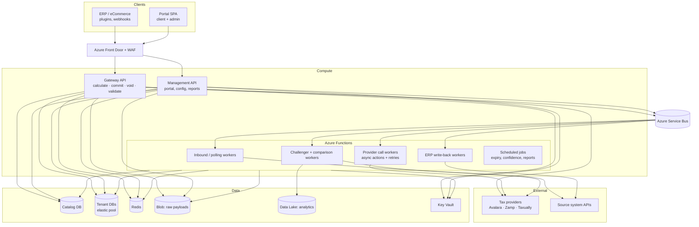
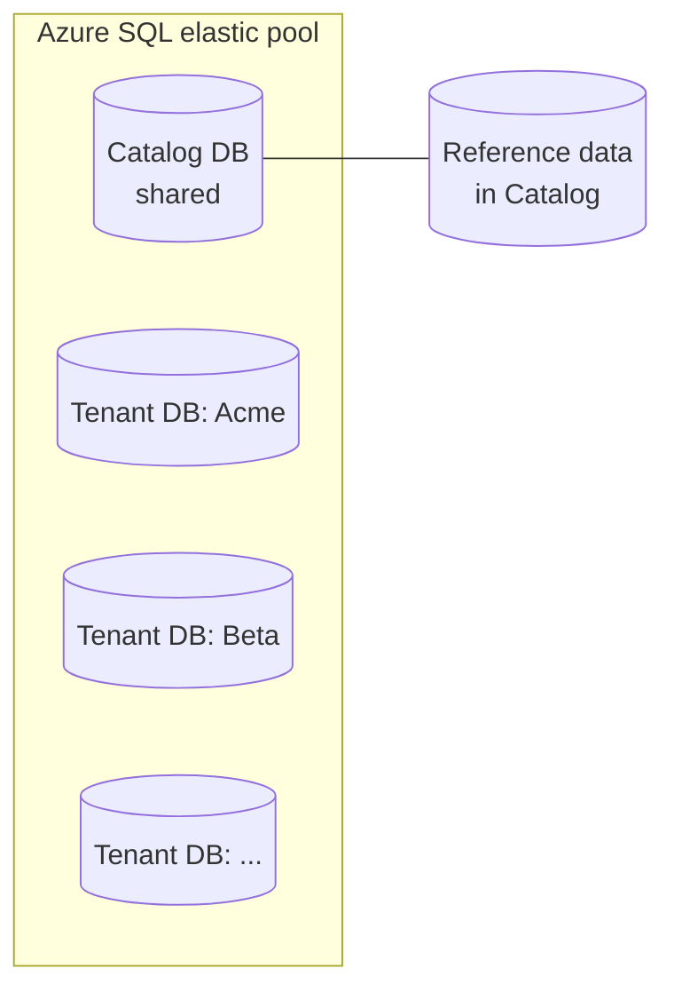
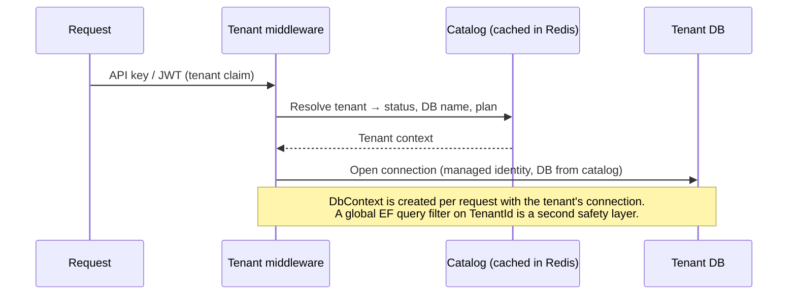
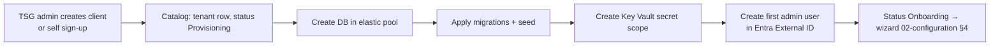
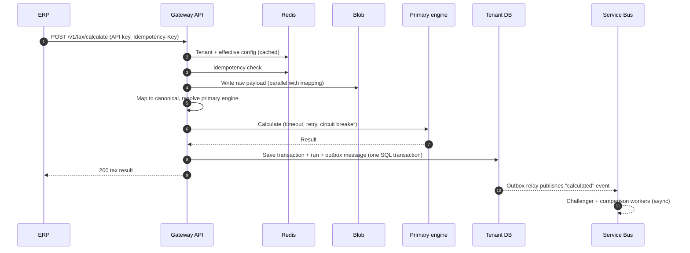
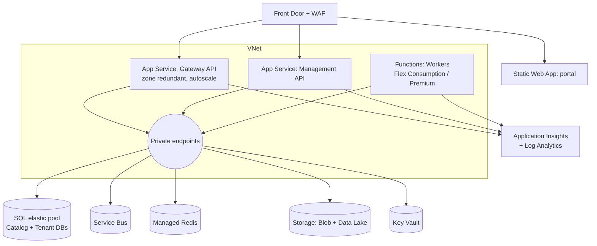
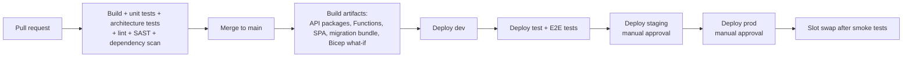

# 08 — Architecture

**Status:** Draft v0.1 · **Date:** 2026-11-21 · **Owner:** TSG

How the gateway is built and run: application structure, database, cloud deployment, UI, security, and how it's operated. Decisions marked **ADR-n** are recommendations that need sign-off. Open items reference [open-questions.md](open-questions.md).

---

## 1. Architecture drivers

| Driver | Source | Architectural consequence |
|---|---|---|
| Real-time calculation inside ERP workflows | 01-workflow §3 mode A | Synchronous API with low added latency. Everything else async. |
| Many connectors, many providers, switch any time | README, W8 | Plug-in adapters behind interfaces. Config-driven routing. |
| Strong tenant isolation | 20 Nov spec | Database per tenant. TenantId everywhere. |
| Store every payload and every engine result | REQ-WF-2, REQ-PAR-4 | Cheap immutable storage for raw data. SQL for queryable data. Analytics store for volume. |
| Parallel engines and comparison | 09-roadmap | Queue-based background processing that scales separately |
| Config takes effect instantly | REQ-CFG-7 | Config cache with change notification |
| Small team, Microsoft skills | 20 Nov spec | .NET + Azure PaaS. A modular monolith first, not microservices. |

## 2. Technology stack

| Layer | Choice | Notes |
|---|---|---|
| Frontend | React 19 + TypeScript, Vite | One SPA with role-based areas (§8) |
| UI kit | Fluent UI React v9 (ADR-6) | Matches Microsoft look; good data grids and accessibility |
| Backend | **.NET 10 (LTS)**, ASP.NET Core Minimal APIs | **ADR-1:** the 20 Nov spec says .NET 8, but .NET 8 support ended on 10 Nov 2026. .NET 10 is the current LTS. |
| Background | Azure Functions (isolated worker, .NET 10) | Service Bus and timer triggers |
| Messaging | Azure Service Bus (Standard → Premium) | Queues, sessions, dead-letter |
| Database | Azure SQL Database, **elastic pool** | Catalog DB + one DB per tenant (§4) |
| Hot cache | Azure Managed Redis | Config cache, tax rate cache hot path, idempotency locks |
| Object storage | Azure Blob Storage (immutable policy for raw payloads) | Raw payloads, exports, reports |
| Analytics | Parquet in Data Lake (ADLS Gen2), queried with Fabric / Synapse serverless | Comparison data at volume (P2+) |
| Secrets | Azure Key Vault | Provider and ERP credentials per tenant |
| Identity | Microsoft Entra External ID (ADR-4) | Email/password + MFA, optional social/enterprise SSO later |
| Edge | Azure Front Door + WAF | TLS, WAF, routing to SPA and APIs |
| Observability | OpenTelemetry → Application Insights / Azure Monitor | Distributed tracing with a correlation ID |
| IaC | Bicep | Azure-native |
| CI/CD | GitHub Actions with OIDC to Azure, GitHub Copilot | No stored Azure secrets in GitHub |
| ORM / data | EF Core 10 (+ Dapper for hot paths and reporting) | Migrations per tenant DB |
| Resilience | Microsoft.Extensions.Http.Resilience (Polly) | Retry, timeout, circuit breaker per provider |

## 3. Logical architecture



### 3.1 Code structure: modular monolith (ADR-2)

One repository and one .NET solution, with clear module boundaries. Deployed as a few apps (Gateway API, Management API, Workers) built from the **same** core libraries. Modules can be split into services later if scale requires it.

```
src/
  Tsg.Gateway.Api/            # HTTP entry for ERPs (sync calls, webhooks)
  Tsg.Management.Api/         # HTTP entry for the portal
  Tsg.Workers/                # Azure Functions (queue/timer triggers)
  Tsg.Core/                   # Canonical model, pipeline, routing, rules for engine selection
  Tsg.Configuration/          # Config hierarchy resolution, explain, locks, events
  Tsg.Engines.Abstractions/   # ITaxEngine, IAddressValidator, IExemptionService
  Tsg.Engines.Avalara/        # Provider adapter
  Tsg.Engines.Zamp/           # Provider adapter
  Tsg.Engines.Taxually/       # Provider adapter
  Tsg.Engines.Cache/          # TSG cache engine
  Tsg.Engines.Rules/          # TSG rules engine
  Tsg.Comparison/             # Compare results, confidence scoring
  Tsg.Connectors.Abstractions/# ISourceConnector, mapping engine
  Tsg.Connectors.Cin7Core/    # Source connector
  Tsg.Connectors.Acumatica/   # Source connector
  Tsg.Tenancy/                # Tenant resolution, connection routing, provisioning
  Tsg.Infrastructure/         # EF Core, Service Bus, Blob, Key Vault, Redis
  Tsg.Contracts/              # Public API DTOs (also used to generate the TS client)
web/
  portal/                     # React SPA
infra/
  bicep/                      # Infrastructure as code
tests/
  ...                         # Unit, contract, integration, end-to-end tests
```

**Dependency rules** (enforced by architecture tests):
- `Tsg.Core` depends only on abstractions, never on a concrete provider or connector (spec principle: *no source- or provider-specific code in business logic*).
- Adapters depend on `*.Abstractions` + `Tsg.Contracts`, never on each other.
- Only `Tsg.Infrastructure` talks to Azure SDKs.

### 3.2 Key interfaces (outline, full contract in 05-providers.md / 04-connectors.md)

```csharp
public interface ITaxEngine            // Avalara, Zamp, Cache, Rules...
{
    EngineDescriptor Descriptor { get; }                 // id, capabilities, countries, cost per call
    Task<TaxResult> CalculateAsync(TaxRequest request, EngineContext ctx, CancellationToken ct);
    Task<CommitResult> CommitAsync(TaxRequest request, EngineContext ctx, CancellationToken ct);
    Task<VoidResult> VoidAsync(VoidRequest request, EngineContext ctx, CancellationToken ct);
    Task<RefundResult> RefundAsync(RefundRequest request, EngineContext ctx, CancellationToken ct);
}

public interface ISourceConnector      // Cin7 Core, Acumatica, Shopify...
{
    ConnectorDescriptor Descriptor { get; }              // supported trigger modes, document types
    Task<IReadOnlyList<RawDocument>> PullAsync(PullWindow window, ConnectorContext ctx, CancellationToken ct);
    Task<RawDocument> ParseWebhookAsync(HttpRequestData request, ConnectorContext ctx, CancellationToken ct);
    Task WriteBackAsync(WriteBackRequest request, ConnectorContext ctx, CancellationToken ct);
}
```

Adapters are registered by **ID** and picked at runtime from configuration (`ProviderRoute`, `PrimaryAssignment`), so switching provider is a data change only.

## 4. Data architecture

### 4.1 Database topology (ADR-3)



| Database | Contents |
|---|---|
| **Catalog DB** (one, shared) | Tenants, tenant → database map, users & roles, licences/plans, global config and locks, provider catalogue & capability matrix, tax change calendar, global Tax Change Events, TSG rules engine data, connector type definitions and mapping templates, cross-tenant aggregates (confidence by engine × scope, if allowed: Q-42) |
| **Tenant DB** (one per client) | Tenant config (countries, routes, cache policy, calc mode), connector instances, master data (customers, items → tax codes, locations), canonical transactions & lines, calculation runs & comparisons, cache entries, idempotency keys, API call log, audit log, outbox |

**Why an elastic pool:** each tenant has its own database for isolation, but they share pooled compute. Small tenants cost very little, and a busy tenant can burst. A large tenant can be moved to its own database or pool without code changes, because the connection string comes from the catalog.

### 4.2 Tenant routing



> **REQ-ARC-1** Each request resolves exactly one tenant before any data access. Requests with no tenant are rejected.
> **REQ-ARC-2** Every tenant table still carries `TenantId` (spec principle), and EF global query filters apply it, as defence in depth.
> **REQ-ARC-3** Apps connect to SQL with **managed identity**. No SQL passwords.

### 4.3 What is stored where

| Data | Store | Why |
|---|---|---|
| Raw inbound payloads | **Blob** (immutable/WORM policy, path `tenant/yyyy/mm/dd/docId/version.json`) + pointer row in Tenant DB | Cheap, tamper-proof audit and reprocessing. Keeps SQL small. |
| Raw provider request/response | Blob + pointer in `CalculationRun` | Same |
| Canonical transactions, lines, results | Tenant DB | Portal search, reports |
| Calculation runs & comparisons (recent, e.g. 90 days) | Tenant DB | Triage, dashboards |
| Calculation runs & comparisons (history) | Data Lake (Parquet), partitioned by tenant/date | Analytics at volume, cheap long-term storage (Q-78) |
| Confidence aggregates | Tenant DB (per tenant) + Catalog (cross-tenant if allowed) | Fast dashboards |
| Tax rate cache | Redis (hot) + Tenant DB `CacheEntry` (source of truth, expiry, audit) | Speed with durability |
| Config | Catalog + Tenant DB. Cached in Redis and memory, invalidated on change. | Instant effect (REQ-CFG-7) |
| Secrets (provider keys, ERP tokens) | Key Vault (reference stored in DB) | Never in SQL or logs |

### 4.4 Schema migrations

- EF Core migrations are built into a **migration bundle** in CI.
- The deployment pipeline runs a **migration job** that applies the bundle to the catalog, then to **every tenant DB** in parallel batches, recording each DB's schema version in the catalog.
- Migrations must be **backward compatible** (expand → deploy → contract), so old and new app versions can run during rollout.
- A failed tenant migration stops that tenant only (it's marked `Maintenance`) and alerts. Other tenants continue.

### 4.5 Tenant provisioning



Provisioning runs as a durable background workflow (Durable Functions), so it can resume after a failure.

## 5. Runtime flows

### 5.1 Real-time calculate (hot path)



> **REQ-ARC-4** Gateway overhead (excluding provider time) p95 ≤ 150 ms. Total p95 ≤ provider p95 + 150 ms (proposal, Q-80).
> **REQ-ARC-5** **Outbox pattern:** a transaction is saved and its event is queued in one database transaction, so an event is never lost and never published for something that wasn't saved.
> **REQ-ARC-6** All handlers are **idempotent**: duplicate messages and retried API calls produce no duplicate provider commits.

### 5.2 Async flows (webhook, polling, write-back)

- **Webhook:** the API verifies the signature (HMAC), stores the raw payload, enqueues it, and returns `202` immediately. A worker processes it through the same pipeline and then enqueues the write-back.
- **Polling:** a timer function enqueues one "poll" message per active connector instance. Workers pull with a **watermark** (last modified date / cursor) stored per connector.
- **Write-back:** a separate queue, rate-limited **per ERP instance** using Service Bus sessions keyed by connector instance, so ERP API limits are respected.
- **Failures:** after retries, messages go to the dead-letter queue → the transaction shows as `Failed` in the portal → the user can **reprocess**, which re-enqueues it from the stored raw payload.

### 5.3 Queues

| Queue / topic | Producer | Consumer | Sessions |
|---|---|---|---|
| `inbound-documents` | Webhooks, polling | Pipeline worker | By tenant |
| `provider-actions` | Pipeline (async commit/void/refund) | Provider worker | By document (keeps order) |
| `writeback` | Pipeline | Write-back worker | By connector instance (rate limit) |
| `calculated` (topic) | Outbox relay | Challenger worker, reporting | — |
| `config-changed` (topic) | Management API | All apps (cache invalidation) | — |
| `provisioning` | Management API | Durable Functions | — |

## 6. Resilience

| Concern | Approach |
|---|---|
| Provider slow or down | Timeout per call (configurable). Retry with jitter on transient errors. **Circuit breaker per provider account**. When the breaker is open, apply the configured fallback policy (Q-35): fail, cached rate, or zero tax + recalculate later. |
| Provider rate limits | Token-bucket limiter per provider account. Honour `Retry-After`. |
| ERP API limits | Per-connector-instance session queues + limiter |
| Duplicate requests | Idempotency key table (TenantId + key + action) with stored response |
| Poison messages | Max delivery count → dead-letter → portal "Failed" list |
| Region outage | Phase 1: zone-redundant services in one region. Later: a secondary region with SQL geo-replication (Q-82). |

## 7. Security

| Area | Design |
|---|---|
| **Portal users** | Entra External ID (OIDC + PKCE). Email/password, MFA (required for admins), password reset. Roles: `TsgAdmin`, `TsgAnalyst`, `ClientAdmin`, `ClientUser` (06-tenancy-security.md). |
| **ERP → Gateway** | Per connector instance: an API key (hashed in DB, rotatable) **or** OAuth2 client credentials. Webhooks verified by HMAC signature + timestamp. |
| **Gateway → providers / ERPs** | Credentials in Key Vault, scoped per tenant. Read with managed identity. Never logged. |
| **Network** | Front Door + WAF in front. App Service / Functions with VNet integration. SQL, Redis, Blob, Key Vault, Service Bus on **private endpoints**, with public access disabled. |
| **Data** | TLS 1.2+ everywhere. Encryption at rest (Azure default, customer-managed keys optional later). PII masking in logs. |
| **Authorisation** | Policy-based: every Management API endpoint checks role + tenant. TSG admins switch tenant context explicitly, and that's audited. |
| **Audit** | Config changes, logins, admin tenant switches, data exports and reprocessing are all written to the audit log. |
| **Compliance** | Region choice for data residency (Q-81). SOC 2 / ISO 27001 path later. |

## 8. UI architecture

### 8.1 Structure

**One React SPA**, with areas shown by role:

```
web/portal/src/
  app/            # routing, layout, auth (MSAL), theming
  api/            # TS client generated from OpenAPI (Tsg.Contracts)
  features/
    dashboard/        # operational + value/savings dashboard
    transactions/     # order/invoice search, detail, reprocess
    onboarding/       # country-based setup wizard
    countries/        # per-country tax setup, provider routing, calc mode
    cache/            # cache policy UI (client + admin views)
    tax-events/       # Tax Change Events, tax calendar
    evidence/         # engine comparison, confidence, promotion board
    triage/           # mismatch triage (admin)
    connectors/       # connector setup & mapping (admin)
    products/         # product tax code mapping, CSV import
    admin-clients/    # tenant list, provisioning, impersonate (admin)
    audit/            # audit log
    settings/         # users, API keys, notifications
  components/     # shared UI (data grid, explain dialog, scope picker)
```

| Concern | Choice |
|---|---|
| Routing | React Router (route guards by role) |
| Server state | TanStack Query (caching, retries, background refresh) |
| Forms | React Hook Form + Zod (the same validation shape as the API) |
| Tables | Fluent UI DataGrid / TanStack Table for large grids with server-side paging |
| Charts | A charting library compatible with Fluent (e.g. Recharts) |
| Auth | MSAL React against Entra External ID |
| API client | Generated from the OpenAPI spec in CI, so types are always in sync |
| i18n | Prepared from day 1 (currency, date and number formats per country) |
| Testing | Vitest + React Testing Library. Playwright for end-to-end tests. |

### 8.2 Hosting

- SPA built to static files → **Azure Static Web Apps** (or Blob + Front Door), served through Front Door on the same domain as the API (`app.<domain>`, `api.<domain>`).
- Admin and client areas are the same app. The API enforces authorisation; the UI only hides what a role can't use.

### 8.3 Reusable UI building blocks (needed across many specs)

- **Scope picker:** Country → Region → Locality → Product tax code. Used by cache, events, evidence and routing.
- **Explain dialog:** shows the effective config and the level each value came from (REQ-CFG-5).
- **Effective-dated editor:** edit a value with `effectiveFrom` / `effectiveTo` and see what's scheduled.
- **Lock badge:** a padlock with the reason when a TSG lock applies.
- **Audit drawer:** history and rollback for any config entity.

## 9. Deployment

### 9.1 Environments

| Env | Purpose | Data | Providers |
|---|---|---|---|
| `dev` | Developer integration | Synthetic | Provider sandboxes |
| `test` | QA, automated end-to-end tests | Synthetic + anonymised | Sandboxes |
| `staging` | Release candidate, client UAT | Client test tenants | Sandboxes (client sandboxes) |
| `prod` | Live | Live | Production accounts |

Each environment is a separate Azure **resource group** (and ideally a separate subscription for prod), built entirely from Bicep.

### 9.2 Azure resources (per environment)



**ADR-5 — App Service + Functions vs Container Apps:** stay with **App Service + Functions** as in the 20 Nov spec. It's simpler for a small .NET team and supports deployment slots. Azure Container Apps is the alternative if we later need container portability or finer scaling. The modular monolith works with either.

### 9.3 CI/CD (GitHub Actions)



- **OIDC federation** from GitHub to Azure. No long-lived secrets in GitHub.
- Order of each deployment: **infra (Bicep) → DB migrations (expand) → apps to the staging slot → smoke test → swap**.
- Feature flags (Azure App Configuration) to switch off new connectors, providers or engines per tenant without redeploying.
- Branch strategy: trunk-based. Short-lived feature branches → PR → `main`. Releases are tagged.

## 10. Observability & operations

| Signal | Implementation |
|---|---|
| Traces | OpenTelemetry. One **correlation ID** from the ERP request → queue messages → provider call → write-back. Shown in the portal transaction detail. |
| API call log | Every external call (REQ-WF-3) in the Tenant DB `ApiCallLog`, with a pointer to the request/response in Blob |
| Metrics | Requests, latency per provider, error rate, circuit breaker state, queue depth, cache hit rate, comparison match rate |
| Alerts | Provider error rate, dead-letter count, failed tenant migration, verification mismatch spike, active Tax Change Event without review |
| Dashboards | Azure Workbooks for ops. Portal dashboards for clients and TSG admins. |
| Backups | Azure SQL automated backups (PITR 7–35 days), long-term retention for audit (Q-78). Blob soft delete + immutability. |

## 11. Non-functional targets (proposals, confirm via Q-80)

| Area | Target |
|---|---|
| Availability (Gateway API) | 99.9% monthly |
| Gateway overhead latency | p95 ≤ 150 ms (excluding provider time) |
| Throughput (MVP) | 50 req/s sustained per region, burst 200 req/s |
| Async processing | 95% of webhooks/polled docs processed + written back ≤ 60 s |
| RPO / RTO | RPO ≤ 15 min, RTO ≤ 4 h (single region, P1) |
| Data retention | Raw + results 7 years (TBC: Q-78) |
| Tenants | 100 tenants in the first pool without redesign |

## 12. What's built when

| Phase | Architecture scope |
|---|---|
| **P1 MVP** | Gateway API, Management API, Workers, Catalog + Tenant DBs, Blob raw storage, Service Bus, Key Vault, Entra External ID, SPA (dashboard, transactions, onboarding, countries, connectors, products, audit), 2 providers, 1–2 connectors, CI/CD, dev/test/prod |
| **P2** | Redis cache engine, challenger/comparison workers, Data Lake export, cache + events + evidence UIs, staging env |
| **P3–P4** | TSG rules engine, triage + promotion board, cross-tenant aggregates, Front Door multi-region (if needed) |

## 13. Decisions summary

| ADR | Decision | Status |
|---|---|---|
| ADR-1 | .NET 10 LTS (not .NET 8) | Proposed |
| ADR-2 | Modular monolith, 3 deployables (Gateway API, Management API, Workers) | Proposed |
| ADR-3 | Catalog DB + database per tenant in a SQL elastic pool. Raw data in Blob. | Proposed |
| ADR-4 | Entra External ID for portal identity | Proposed |
| ADR-5 | App Service + Azure Functions (not Container Apps) | Proposed |
| ADR-6 | Fluent UI React v9 as the UI kit | Proposed |
| ADR-7 | Service Bus with the outbox pattern for all async work | Proposed |
| ADR-8 | Bicep for IaC, GitHub Actions with OIDC | Proposed |
