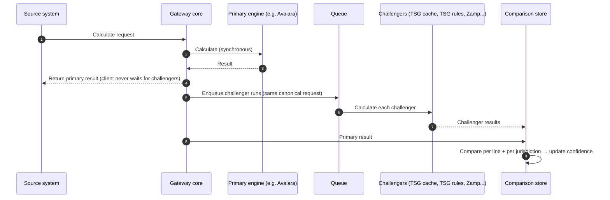

# 09 — Parallel Calculation, Evidence & Roadmap

**Status:** Draft v0.2 · **Date:** 2026-11-21 · **Owner:** TSG

## 1. Principle: prove it, don't assume it

For every request, **more than one engine calculates the tax**. All results are stored and compared. **One engine (the primary) answers** the client. The others (**challengers**) run in the background.

Over time the comparison data builds **measured confidence** for each engine in each country, region and product type. Choosing which engine is primary is then a decision based on that evidence, not an assumption.

Engines that can take part:

| Engine | Cost per call | Example |
|---|---|---|
| External provider | Paid | Avalara, Zamp, Taxually |
| TSG cache | Free | Rates reused from earlier provider answers (W9) |
| TSG rules engine | Free | TSG's own rates and rules |

This also compares **providers with each other**. Avalara and Zamp don't always agree, so the evidence shows clients which calculator is most reliable for their destinations.

## 2. How it works

> **REQ-PAR-1** **Primary answers, challengers observe.** Only the primary's result is returned or written back. Challenger results are never shown to the ERP.
> **REQ-PAR-2** **Never slower.** Challengers run asynchronously after the response. A challenger failure never affects the client.
> **REQ-PAR-3** **Same input.** Challengers receive exactly the same canonical request (same addresses, tax codes, amounts, date) as the primary.
> **REQ-PAR-4** **Store everything:** request, every engine's full result (line × jurisdiction), latency, cost, engine/rule version.
> **REQ-PAR-5** **Free engines always run** (TSG cache, TSG rules) on every request. **Paid challengers** (a second provider) run on a configurable sample %, because they double the cost.
> **REQ-PAR-6** Challengers that write data (commit, void, refund) are **never** run against a paid provider. Only calculate/estimate calls are duplicated.

## 3. Comparison

For each request and each primary–challenger pair:

| Compared | Match rule (configurable) |
|---|---|
| Total tax | Within tolerance (proposal: ≤ $0.01 or ≤ 0.01%) |
| Tax per line | Within tolerance |
| Jurisdictions returned (state, county, city, special districts) | Same set |
| Rate per jurisdiction | Equal to 4 decimal places |
| Taxability per line (taxable / exempt / zero-rated) | Equal |

Each mismatch is stored with *where* it differs: which line, jurisdiction, product tax code and amount.

**Mismatch triage** (admin screen): a TSG analyst labels each type of mismatch:

| Label | Meaning | Effect |
|---|---|---|
| `CHALLENGER_WRONG` | e.g. the TSG rule is out of date | Fix the rule. Counts against the challenger. |
| `PRIMARY_WRONG` | The provider was wrong | Counts against the provider. Possibly raise it with the provider. |
| `MAPPING_ISSUE` | Wrong product tax code or address | Fix the client's configuration. Excluded from engine scores. |
| `RATE_CHANGE_TIMING` | One engine updated earlier than the other | Excluded. Check the Tax Change Event calendar. |
| `ROUNDING` | Rounding-method difference | Tune the tolerance. |

> **REQ-PAR-7** Mismatches are grouped (same scope + product tax code + difference pattern) so analysts triage patterns, not individual transactions.
> **REQ-PAR-8** Triage labels feed the confidence score (§4). Unlabelled mismatches count as failures.

## 4. Confidence

Calculated per **engine × scope**, where scope = country → region → locality, optionally × product tax code, over a rolling window.

| Metric | Description |
|---|---|
| Sample size | Number of compared requests in the window |
| Match rate | % matching within tolerance |
| **Confidence (lower bound)** | Statistical lower bound of the match rate (e.g. 95% Wilson interval), so 10 out of 10 matches doesn't count as "100% proven" |
| Worst difference | Largest $ and % difference in the window |
| Last mismatch | Date and label |
| Days stable | Days since the last unexplained mismatch |

**Eligible to become primary** (proposal, configurable per scope):
- confidence lower bound ≥ 99.9%,
- sample size ≥ 1,000 requests **and** ≥ 90 days,
- no unexplained mismatch in the last 30 days,
- no active Tax Change Event for the scope.

> **REQ-PAR-9** The system **recommends** a primary per scope from the evidence. A TSG admin (and the client, if their mode allows it) **approves** the change. Changes are never automatic.
> **REQ-PAR-10** **Automatic fallback:** if the current primary is a TSG engine and its confidence drops below threshold, or a Tax Change Event starts, the primary reverts to the external provider immediately and alerts TSG.
> **REQ-PAR-11** Every stored result records `primaryEngine`, the challengers that ran, and the comparison outcome. This is the audit evidence for any tax authority or client question.

## 5. What the client chooses

The client still chooses **Live** or **Improved** per country ([02-configuration.md](02-configuration.md) §10). Parallel calculation runs in **both** modes, so the evidence builds even for Live clients.

| Mode | Primary engine | Challengers |
|---|---|---|
| **Live** | Always the chosen external provider | TSG cache + TSG rules (free). Optional second provider (sampled). |
| **Improved** | The engine with the best **proven** confidence for that scope, approved by TSG | All others, including the external provider on a verification sample |

**Sales story:** *"We don't ask you to trust us. Every one of your calculations is checked by more than one engine. Here's the evidence for your destinations, and you decide when to switch."*

## 6. Analysis screens

| Screen | Who | Shows |
|---|---|---|
| **Evidence dashboard** | Client (own data), admin (all) | Per country/region: engines compared, match rate, confidence, current primary, recommended primary, $ that could be saved by switching |
| **Engine comparison** | Admin | Engine vs engine heat map by state/country and product tax code |
| **Mismatch triage** | Admin | Grouped mismatches, drill-down to transactions, labelling |
| **Promotion board** | Admin | Scopes eligible for a primary change, with Approve / Reject |
| **Provider reliability** | Admin, sales | Avalara vs Zamp vs Taxually agreement per destination, used to advise clients |

## 7. Data (outline, details in 03-domain-model.md)

| Entity | Key fields |
|---|---|
| `CalculationRun` | RunId, TransactionId, TenantId, Engine, EngineVersion, Role (PRIMARY/CHALLENGER), Status, LatencyMs, Cost, ResultJson |
| `ComparisonResult` | TransactionId, PrimaryRunId, ChallengerRunId, Match, TotalDiff, LineDiffs, JurisdictionDiffs, PatternKey |
| `MismatchGroup` | PatternKey, Scope, ProductTaxCode, Count, Label, LabelledBy, Notes |
| `EngineConfidence` | Engine, Scope, ProductTaxCode?, Window, SampleSize, MatchRate, LowerBound, WorstDiff, LastMismatchAt |
| `PrimaryAssignment` | Scope, Engine, EffectiveFrom, ApprovedBy, EvidenceSnapshotId |

*Volume note:* storing every engine's result for every request multiplies storage by the number of engines. Detailed results move to cheaper storage after N days; aggregates stay in SQL (Q-78).

## 8. Roadmap phases

| Phase | Delivers |
|---|---|
| **P1 — Gateway MVP** | Connectors (1–2 ERPs), Avalara + Zamp adapters, W1–W8, portal, country onboarding. **`CalculationRun` stores every primary result from day 1.** |
| **P2 — Cache + parallel framework** | Challenger queue, comparison engine, the TSG cache as the first challenger, cache UI, tax change events, evidence dashboard |
| **P3 — TSG rules engine as challenger** | Rules for flat-rate countries and single-rate states run on every request. Mismatch triage. Optional second-provider sampling. |
| **P4 — Evidence-based switching** | Confidence scores, promotion board, Improved mode with a TSG primary where proven, automatic fallback |
| **P5 — Broaden** | More regions and product rules, licensed rate data (Q-45), commits from a TSG primary if approved (Q-71) |

## 9. Where we expect evidence first

Expectations only. The data decides:

| Scope | Expectation |
|---|---|
| AU / NZ / SG (flat-rate GST) | High agreement quickly |
| US single-rate states with no local tax | High agreement |
| Repeat destinations (cache) | High agreement until rates change |
| Complex US local jurisdictions (CO, LA, AL, AZ) | Low agreement for a long time. Provider stays primary. |
