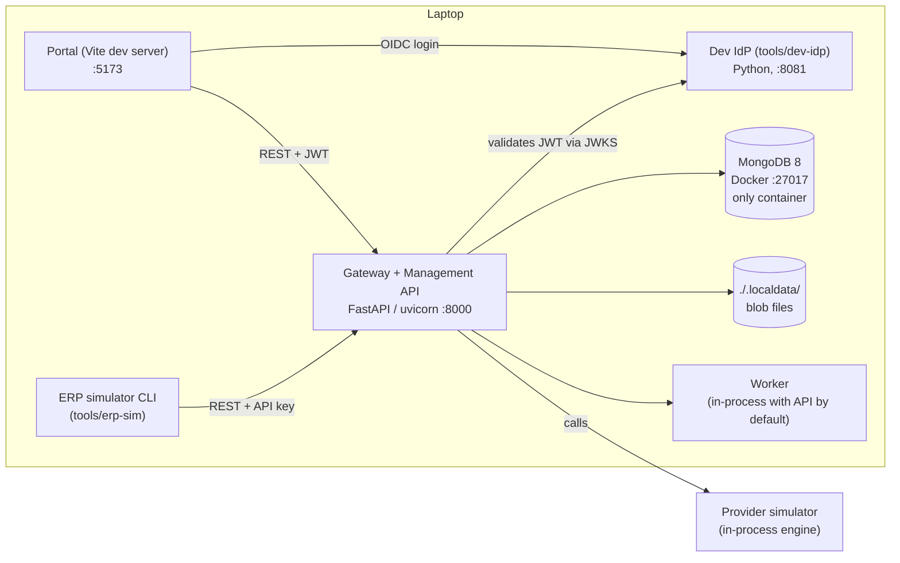
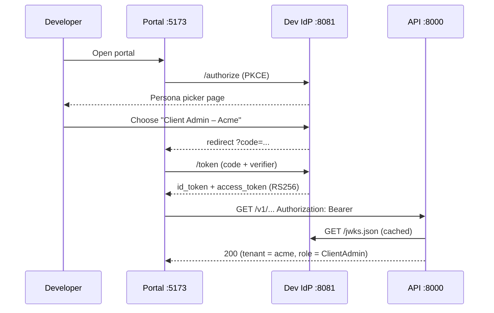

# 10 — Local Development & Testing

**Status:** Draft v0.2 · **Date:** 2026-11-22 · **Owner:** TSG

## 1. Goals

| # | Goal |
|---|---|
| G1 | **No Azure (or any cloud) needed** to develop, run or test. No cloud accounts, emulators or internet access needed for the default setup. |
| G2 | **Small:** one container (MongoDB). Everything else runs as plain processes. Target **≤ 1 GB RAM** and **≤ 1 GB disk** for the local stack. |
| G3 | **Same code paths as production.** Local uses the same app, the same ports and the same JWT validation. Only the adapters differ. |
| G4 | **Login works locally** with a local identity provider (IdP) and ready-made test users for every role. |
| G5 | **Up in minutes:** clone → `make setup` → `make dev` gives a working portal with seeded data. |
| G6 | **Unit tests need nothing**: no Docker, no DB, no network. |

## 2. Local stack



### 2.1 Local adapter profile (`CLOUD=local`)

| Port | Production (Azure) | **Local** | Unit tests |
|---|---|---|---|
| `DocumentStore` | Cosmos DB for MongoDB | **MongoDB 8 in Docker** | In-memory adapter |
| `BlobStore` | Azure Blob | **Filesystem** (`./.localdata/blob/…`) | In-memory |
| `MessageBus` | Storage Queue → Service Bus | **In-process** (asyncio queue, same handlers). Optional **Mongo-backed queue** to test retries/DLQ. | In-memory, synchronous |
| `SecretStore` | Key Vault | **`.env.local` file** (git-ignored) | Dict |
| `Cache` | Memory → Redis | **In-memory** | In-memory |
| `TaxEngine` (providers) | Avalara / Zamp / Taxually | **Provider simulator** (§5). Optionally the real provider **sandbox** if keys are in `.env.local`. | Fake engine |
| `SourceConnector` | Cin7 / Acumatica | **ERP simulator** (§6) + recorded fixtures | Fake connector |
| Identity (OIDC) | Entra External ID | **Dev IdP** (§4) | Tokens minted by a test fixture |
| `Clock` | System UTC | System UTC (overridable for tests) | Fixed/fake clock |

No Azurite, no Azure Functions Core Tools and no cloud SDK calls are needed locally. The Functions/Lambda entry points are thin wrappers, tested in CI with unit tests (§7.3).

## 3. Commands

One `Makefile` (or `justfile`) at the repo root. Every command is plain `uv` / `npm` / `docker compose` underneath.

| Command | Does |
|---|---|
| `make setup` | Installs Python 3.13 via uv, `uv sync`, `npm ci` in `web/portal`, installs pre-commit hooks, creates `.env.local` from `.env.example` |
| `make db` | Starts MongoDB only (`docker compose up -d mongo`) |
| `make dev` | `make db`, then runs **API + worker** (uvicorn with reload), **dev IdP** and **portal** (Vite) together, with combined colour-coded logs |
| `make seed` | Loads the demo dataset (§8) — idempotent |
| `make reset` | Drops local databases and `./.localdata`, then reseeds |
| `make test` | Unit + contract tests (in-memory). **No Docker needed.** |
| `make test-int` | Integration tests with Testcontainers (MongoDB) |
| `make test-e2e` | Starts the full local stack and runs Playwright + API journey tests |
| `make check` | ruff, mypy, import-linter, eslint, tsc — the same as CI |
| `make demo` | Fully containerised stack (`docker compose --profile full up`): api, idp, web, mongo. For people who don't want Python/Node installed. |
| `make down` | Stops containers |

## 4. Local identity provider (dev IdP)

### 4.1 Approach

A **tiny OIDC provider written in Python**, kept in the repo at `tools/dev-idp/`. It runs from the same uv environment, so there's no extra image.

- `GET /.well-known/openid-configuration`: standard discovery document.
- `GET /jwks.json`: public signing key (RS256, a key pair generated on first run into `./.localdata/idp/`).
- `GET /authorize`: shows a **persona picker** page (no passwords). Click a user → redirect back with an auth code. Supports **Authorization Code + PKCE**, exactly like the production flow.
- `POST /token`: returns an ID token and an access token with standard claims plus our custom claims.
- `GET /logout`: ends the session.

The **backend doesn't know it's local**: it validates tokens with the same generic OIDC/JWKS code as production, pointed at `OIDC_ISSUER=http://localhost:8081`. The **portal** uses the same `react-oidc-context` setup, with a different issuer URL in `.env.local`.



### 4.2 Personas (seeded, editable in `tools/dev-idp/personas.yaml`)

| Persona | Role | Tenant | Use for testing |
|---|---|---|---|
| `tsg.admin@dev.local` | `TsgAdmin` | all (can switch) | Onboarding, configuration, provider switch, global config, locks, promotion board |
| `tsg.analyst@dev.local` | `TsgAnalyst` | all (read + triage) | Mismatch triage, evidence. Becomes the TSG consultant persona if Q-101 adds that role |
| `admin@acme.dev.local` | `ClientAdmin` | `acme` | Merchant admin: read-only transactions (Q-20). Edit rights depend on Q-100 |
| `user@acme.dev.local` | `ClientUser` | `acme` | Read-only portal (kept for later; not an MVP role) |
| `admin@beta.dev.local` | `ClientAdmin` | `beta` | **Tenant isolation**: must never see Acme data |
| `locked@acme.dev.local` | `ClientUser` (disabled) | `acme` | Rejected-login and disabled-user paths |

Token claims follow the same contract as production: `sub`, `email`, `name`, `roles`, `tenant_id`, `iss`, `aud`, `exp`. The claim names are configured in one place, so mapping them to Entra External ID claims later is configuration only.

### 4.3 Testing without a browser

- **pytest fixture** `auth_token(persona="admin@acme.dev.local")` mints a token signed with the dev key, so API tests never call the IdP.
- **CLI:** `uv run dev-idp token --persona admin@acme.dev.local` prints a bearer token for curl/Postman/Bruno.
- **Expired/invalid token helpers** (`--expired`, `--wrong-audience`, `--tampered`) to test rejection paths.

### 4.4 Machine-to-machine (ERP → gateway)

- Seeded **API keys** per connector instance (e.g. `acme-cin7-dev`), printed by `make seed` and stored hashed in MongoDB, exactly like production.
- An optional OAuth2 **client credentials** grant in the dev IdP (`POST /token` with `client_id`/`client_secret` from `personas.yaml`) to test that flow.

### 4.5 Safety

> **REQ-DEV-1** The dev IdP, the provider simulator and the ERP simulator live under `tools/`. They're **excluded from production packages and images**.
> **REQ-DEV-2** At start-up, settings validation **refuses to start** if `APP_ENV` isn't `local`/`test` while `OIDC_ISSUER` points to localhost, the simulator engine is enabled, or secrets come from `.env.local`.
> **REQ-DEV-3** The dev IdP binds to `127.0.0.1` only and prints a banner on every page: "DEVELOPMENT IDENTITY PROVIDER — NOT FOR PRODUCTION".

## 5. Provider simulator

An in-process `TaxEngine` adapter (`tools/provider-sim`) so development needs no provider accounts or internet. **`sim-zamp` comes first**, since Zamp is the only MVP provider (Q-06). `sim-avalara` and `sim-taxually` follow when they're needed (for parallel calculation and the UK).

- **Zamp-shaped API:** calculate, commit, void, and address validation and exemption checks if Zamp offers them (Q-105), so the real Zamp adapter is tested against the simulator first.
- **Rate tables in YAML** (`tools/provider-sim/rates/*.yaml`): state/county/city/special district/ZIP → jurisdiction rates, product tax code taxability, exemptions. Built from [tax-reference/united-states.md](tax-reference/united-states.md) for the MVP, plus the simple countries in [tax-reference/](tax-reference/README.md) (AU, NZ, SG, JP, UK, US MI/IN). Expected results come from [tax-reference/test-scenarios.md](tax-reference/test-scenarios.md).
- **Customers and addresses:** seeded exempt customers (with certificate expiry dates) and addresses that fail validation or resolve to several jurisdictions, to test the customer & address store.
- **Deterministic results**, so tests can assert exact cents.
- **Disagreement knobs:** `sim-zamp` can be configured to differ from `sim-avalara` for chosen scopes, to exercise parallel calculation, comparison, triage and confidence locally.
- **Fault injection:** latency, timeouts, 429 with `Retry-After`, 5xx, malformed responses, configurable per engine (`SIM_FAULTS=sim-avalara:timeout:10%`). Used to test retries, the circuit breaker and fallback.
- **Commit/void/refund state** is kept in MongoDB (`sim_*` collections), so the full lifecycle works.
- **Real sandbox option:** put the provider sandbox credentials in `.env.local` and route a tenant to `avalara` instead of `sim-avalara`. The internet is needed in that case, but still no Azure.

## 6. ERP simulator

`tools/erp-sim`: a CLI that plays the role of a source system.

| Command | Simulates |
|---|---|
| `erp-sim calculate --tenant acme --sample so-multi-line` | Real-time "Calculate Tax" button (mode A, REST) |
| `erp-sim webhook --tenant acme --sample invoice-final` | Webhook push (mode B), signed with the dev HMAC secret |
| `erp-sim serve --port 8090` | A fake ERP API that the **polling** connector can pull from, and that receives **write-back** calls (logged and inspectable at `/inspect`) |
| `erp-sim load --tenant acme --rate 20/s --duration 60s` | Simple local load test |

Samples (`tools/erp-sim/samples/`) are ERP payloads per connector, **Cin7 Omni first** (Q-10), taken from sandbox recordings with personal data scrubbed. The fake ERP API also simulates write-back rejections (REQ-WF-11) and the per-client status → action mapping (Q-15).

## 7. Testing strategy (all local, no cloud)

### 7.1 Test levels

| Level | Needs | Adapters | Runs |
|---|---|---|---|
| **Unit** | Python only | In-memory (all ports) + fake clock | `make test`, every save (watch mode), every PR |
| **Contract** | Python only (+ Docker for the Mongo variant) | The same test suite run against **every** adapter of a port (memory, mongo, filesystem, ...) | Every PR |
| **Integration** | Docker | Testcontainers MongoDB, filesystem blob, in-process/Mongo queue, provider simulator | Every PR |
| **API journeys** | Docker | Full app in-process (`httpx.AsyncClient` + ASGI transport), tokens from the fixture | Every PR |
| **E2E** | Docker + Node | Full local stack + dev IdP + Playwright (real browser login via the persona picker) | Every PR (smoke) / nightly (full) |
| **Cloud compatibility** *(optional, not local)* | A dev cloud account | Same contract suite against Cosmos DB / Blob / Service Bus | Nightly in CI only. Never required for developers. |

### 7.2 Must-have test suites

- **Tenant isolation:** every repository and endpoint tested with the Acme and Beta personas (REQ-ARC-3).
- **Auth:** valid, expired, wrong audience, wrong issuer, tampered, missing role, disabled user.
- **Money:** Hypothesis property tests for rounding, multi-line totals and currency mismatch.
- **Resilience:** simulator faults → retries, circuit breaker opens and closes, fallback policy.
- **Idempotency:** a repeated `Idempotency-Key` returns the same response and never commits twice.
- **Parallel calculation:** primary vs challenger disagreement → comparison stored → confidence updated.
- **Config resolution:** table-driven tests for the hierarchy, locks, tax events and explain.

### 7.3 Serverless entry points without the cloud

- The Azure Functions (`function_app.py`) and Lambda (`handler.py`) entry points stay **under ~50 lines each**. They only adapt the trigger to the shared app/handlers.
- They're unit-tested by building the trigger objects (the `azure.functions` HTTP/queue request types, and Lambda event dicts as JSON fixtures) and asserting that the shared handler gets called. No Functions host is needed.
- Running the real Functions host locally (`func start`) is **optional** and documented, never required.

## 8. Seed data (`make seed`)

| Data | Content |
|---|---|
| Tenants | `acme` (US, Cin7 Omni, `sim-zamp`), `beta` (US + AU, for multi-country tests) |
| Users | The personas in §4.2 |
| Config | Global defaults, a TSG lock (cache off for CA), an active Tax Change Event (UK), country templates |
| Provider routes | Acme US → `sim-zamp`. Beta AU → TSG rules. Challengers come with P2. |
| Master data | ~50 products with expected tax codes (some deliberately different from the ERP's, for tax code exceptions), 1 warehouse per client (Q-17), ~20 customers with customer code and tax ID (some exempt, one with an expired certificate) |

| Transactions | ~500 historical orders/invoices across states, including failed, voided and refunded ones, with comparison data so dashboards aren't empty |
| API keys | One per connector instance, printed to the console |

The seed uses the **public application APIs/use cases** (not direct DB inserts), so it also works as a smoke test.

## 9. Footprint

| Component | Type | Approx. RAM |
|---|---|---|
| MongoDB 8 (`--wiredTigerCacheSizeGB 0.25`, container limit 512 MB) | Docker | ≤ 512 MB |
| API + worker (uvicorn, 1 process) | Python | ~150 MB |
| Dev IdP | Python | ~50 MB |
| Portal dev server (Vite) | Node | ~200 MB |
| **Total** | | **≈ 0.9 GB** |

`docker-compose.yml` (outline):

```yaml
services:
  mongo:
    image: mongo:8
    command: ["--replSet", "rs0", "--wiredTigerCacheSizeGB", "0.25", "--bind_ip_all"]
    ports: ["127.0.0.1:27017:27017"]
    volumes: ["mongo-data:/data/db"]
    mem_limit: 512m
    healthcheck:
      test: ["CMD", "mongosh", "--quiet", "--eval", "try{rs.status().ok}catch(e){rs.initiate().ok}"]
      interval: 5s
  # 'full' profile only (make demo): api, worker, dev-idp, web
volumes:
  mongo-data:
```

A single-node **replica set** is used so change streams and transactions behave like the cloud services (needed for the outbox relay, §6.3 of 08-architecture).

## 10. Developer experience

- **Supported OS:** Linux, macOS, Windows via WSL2.
- **Prerequisites:** Docker (or Podman), uv, Node 22 LTS, make. That's all.
- **Dev container** (`.devcontainer/`) for VS Code / Codespaces, with the same tools preinstalled (optional).
- **`.env.example`** documents every setting with local defaults. `.env.local` is git-ignored.
- **API exploration:** FastAPI Swagger UI at `http://localhost:8000/docs`, with "Authorize" pre-wired to the dev IdP. A Bruno/Postman collection lives in `tools/api-collection/`.
- **Logs:** human-readable coloured console locally (`LOG_FORMAT=console`), JSON in the cloud. Same structlog setup.
- **Hot reload:** uvicorn `--reload` for the API, Vite HMR for the portal.

## 11. Requirements summary

> **REQ-DEV-4** `make test` passes on a clean machine with **only Python/uv installed**: no Docker, no network.
> **REQ-DEV-5** `make dev` starts the full local stack with **one container** (MongoDB) and works offline after the first `make setup`.
> **REQ-DEV-6** Every port has an in-memory adapter and a local adapter, and both pass that port's contract test suite.
> **REQ-DEV-7** CI runs the same `make check`, `make test`, `make test-int` and `make test-e2e` targets as developers. No cloud services are needed for any required CI job.
> **REQ-DEV-8** A new developer goes from clone to a logged-in portal with seeded data in **≤ 15 minutes**.
