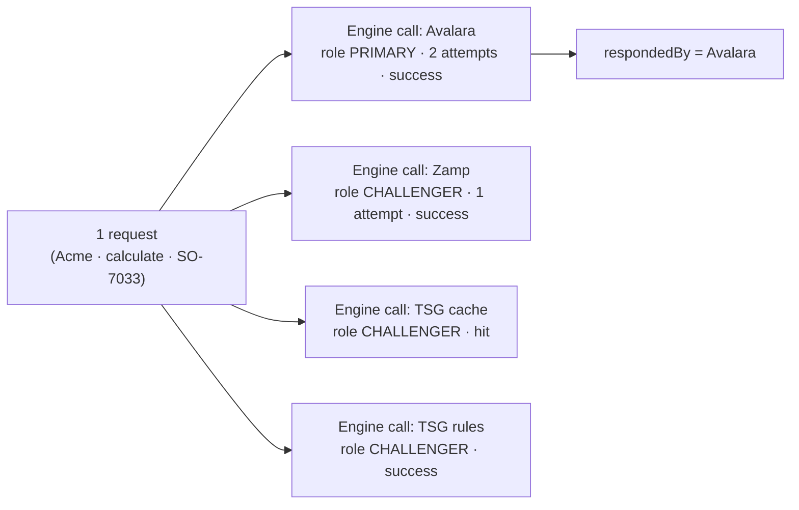
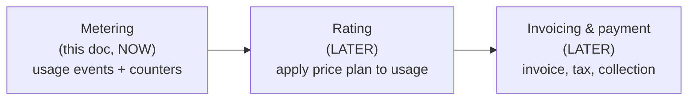

# 11 — Usage Metering (and Billing Roadmap)

**Status:** Draft v0.1 · **Date:** 2026-11-21 · **Owner:** TSG

**In scope now:** count every request each client sends, and every call to each calculator (who was asked, who answered, the outcome).
**Not in scope now:** billing, meaning pricing, invoices and payments. It's a roadmap item (§7). The metering is designed so billing can be added later **without changing how usage is captured**.

---

## 1. Questions metering must answer

| # | Question | Example |
|---|---|---|
| U1 | How many requests did a client send, by period, action, source system and country? | Acme: 48,210 calculate, 9,870 commit in November |
| U2 | How many calls went to **each calculator** for that client? | Avalara 41,000 · Zamp 7,200 · Taxually 3,100 · TSG cache 22,400 · TSG rules 48,210 |
| U3 | **Who responded**: which engine's answer was actually returned? | Avalara answered 38,900, TSG cache 9,310 |
| U4 | How many calls were primary (answered the client) vs challenger (background comparison)? | Zamp: 600 primary, 6,600 challenger |
| U5 | Outcomes per calculator: success, failure, timeout, rate-limited, fallback used | Avalara 0.4% timeouts in week 46 |
| U6 | How many **attempts** (including retries) vs **logical calls**? | 41,000 logical, 41,350 attempts. Matters because some providers bill per attempt. |
| U7 | Does our count match the provider's own usage report? | Reconcile against the Avalara monthly statement |

## 2. Concepts

| Term | Meaning |
|---|---|
| **Request** | One inbound call from a client system (REST call, webhook, polled document) for one action on one document |
| **Engine call** | One logical call from the gateway to one engine (provider, TSG cache, TSG rules) for one request. One request can produce several engine calls (primary + challengers + fallback). |
| **Attempt** | One physical HTTP call to a provider. One engine call can have several attempts (retries). |
| **Responder** | The engine whose result was returned to the client for that request (`respondedBy`) |
| **Role** | `PRIMARY` · `CHALLENGER` · `FALLBACK` (used because the primary failed) |
| **Provider-billable** | Whether the call is likely to count on the provider's invoice (e.g. Avalara commit = yes, TSG cache = no) |



## 3. What is recorded

### 3.1 Usage events (append-only)

Emitted by the pipeline as events (`tsg.usage.request.v1`, `tsg.usage.engine_call.v1`) through the `MessageBus`, so the hot path isn't slowed down.

**Request event**

| Field | Example |
|---|---|
| `eventId` (ULID, unique) | `01JD9…` |
| `tenantId` | `acme` |
| `requestId` / `correlationId` | |
| `occurredAt` (UTC) | |
| `action` | `CALCULATE` · `COMMIT` · `VOID` · `REFUND` · `ADDRESS_VALIDATE` · `EXEMPTION_CHECK` |
| `source` | connector type + instance (`cin7core/acme-01`) |
| `triggerMode` | `REALTIME` · `WEBHOOK` · `POLL` |
| `country` / `region` | `US` / `TX` |
| `documentType` | `SALES_ORDER` · `INVOICE` · `CREDIT_NOTE` |
| `lineCount` | `3` |
| `respondedBy` | `avalara:acct-123` |
| `outcome` | `SUCCESS` · `FAILED` · `REJECTED` · `DUPLICATE` (idempotent replay) |
| `latencyMs` | |
| `calculationMode` | `LIVE` · `IMPROVED` |

**Engine call event**

| Field | Example |
|---|---|
| `eventId`, `tenantId`, `requestId`, `occurredAt` | |
| `engineId` + `providerAccountId` | `zamp` + `acct-zamp-acme` |
| `engineType` | `PROVIDER` · `TSG_CACHE` · `TSG_RULES` |
| `role` | `PRIMARY` · `CHALLENGER` · `FALLBACK` |
| `action` | as above |
| `attempts` | `2` |
| `outcome` | `SUCCESS` · `TIMEOUT` · `RATE_LIMITED` · `PROVIDER_ERROR` · `CIRCUIT_OPEN` · `CACHE_HIT` · `CACHE_MISS` |
| `providerBillable` | `true` / `false` |
| `latencyMs` | |
| `country` / `region` | |

> **REQ-USE-1** Every inbound request produces exactly one request event, including rejected, failed and duplicate (idempotent replay) requests, each with its outcome.
> **REQ-USE-2** Every engine call (any role, any engine, cache included) produces exactly one engine call event, with its attempt count.
> **REQ-USE-3** `respondedBy` is recorded on every request that returned a tax result.
> **REQ-USE-4** Usage events are **immutable**. Corrections are new events of type `adjustment`, never edits.
> **REQ-USE-5** Counting is **idempotent**: counters are updated once per `eventId`, even if a message is delivered twice.

### 3.2 Storage

| Collection | Content | Retention |
|---|---|---|
| `usage_events` | Raw events (partition key `tenantId`) | e.g. 13 months in the DB → Parquet archive (Q-78) |
| `usage_counters` | Pre-aggregated counters per **tenant × day × action × engine × role × outcome × country**, updated with atomic `$inc` upserts | Long term (small) |
| `usage_counters_hourly` *(optional)* | Same at hourly grain, for operations | 30 days |

Counter documents keep the portal fast and cheap. The UI never scans raw events for normal screens. The raw events remain the **source of truth** if counters ever need rebuilding (`make rebuild-usage` / an admin job).

## 4. Screens

### 4.1 Client: "Usage"
```
┌ Usage ──────────────── Acme Pty Ltd ── Nov 2026 ▾ ── [Export CSV] ┐
│ Requests: 58,080   Success 99.6%   Avg latency 420 ms            │
├──────────────────────────────────────────────────────────────────┤
│ Calculator    Responded  Primary  Challenger  Fallback  Failures │
│ Avalara        38,900    41,000        —         120      0.4%   │
│ Zamp              600       600     6,600          —      0.2%   │
│ Taxually        3,100     3,100        —           —      0.1%   │
│ TSG cache       9,310     9,310    22,400          —        —    │
│ TSG rules       6,170     6,170    48,210          —        —    │
├──────────────────────────────────────────────────────────────────┤
│ [By day ▾] [By action ▾] [By country ▾] [By source ▾]            │
└──────────────────────────────────────────────────────────────────┘
```
*(Whether clients see challenger counts depends on Q-76.)*

### 4.2 Admin: "Usage across clients"
- Clients × calculators matrix for a period, sortable.
- Drill-down: client → calculator → day → individual requests (via `requestId`).
- **Provider reconciliation:** our provider-billable count per provider account per month, next to the number from the provider's statement (entered manually or imported), with the difference highlighted.
- Spikes and anomalies: a client's volume up or down > X% day on day (alert).

### 4.3 API

`GET /v1/usage?from=2026-11-01&to=2026-11-30&groupBy=engine,action,day&role=PRIMARY`
returns aggregated counters (tenant-scoped for client roles, any tenant for TSG roles). The same data feeds the CSV export.

## 5. Value dashboard link

Usage counters feed the value dashboard ([02-configuration.md](02-configuration.md) §9). For example, "calls avoided" = TSG engine responses × indicative provider cost per call.

## 6. Optional soft limits (not billing)

Configurable **alerts only** at first: "notify when Acme exceeds 50,000 requests this month" or "when Zamp challenger calls exceed 10,000". No blocking. Hard quotas come with billing (§7).

## 7. Billing (roadmap, not now)

### 7.1 Principle: metering ≠ rating ≠ invoicing



Because metering is complete and immutable, any pricing model can be applied later, including re-rating past periods to compare plans.

### 7.2 Pricing models to support (as data, not code)

| Model | Example |
|---|---|
| Per transaction | $0.05 per committed invoice |
| Included allowance + overage | First 1,000 requests/month included, then $0.04 each |
| Tiered: graduated | 0–10k at $0.05, 10k–50k at $0.03, 50k+ at $0.02 (each tier priced separately) |
| Tiered: volume | Whole month priced at the tier reached (e.g. 60k → all at $0.02) |
| Packages / blocks | $300 per block of 10,000 requests |
| Flat subscription + usage | $199/month platform fee + per-transaction |
| Per country / connector / provider add-ons | +$50/month per extra country or ERP connector |
| Prepaid credits / drawdown | Buy 100k credits, consumed by usage |
| Minimum commitment | $500/month minimum, usage counted against it |
| Savings share | X% of provider cost saved by the cache / TSG engine (ties to Improved mode) |
| Pass-through + margin | When TSG resells provider calls: provider cost + Y% |
| Discounts, free trials, promos | Time-limited or volume-based |

### 7.3 Billable metric definitions (to decide later)

The price plan references a **billable metric** defined over the usage counters, for example:
- `committed_invoices` = request events with `action=COMMIT, outcome=SUCCESS`
- `calculations` = `action=CALCULATE, outcome=SUCCESS`, excluding `DUPLICATE`
- `provider_calls_resold` = engine call events with `providerBillable=true`, on a TSG master account
- Challenger calls and TSG-internal engines are **probably not billed** to clients (Q-93)

### 7.4 Build vs buy

Rather than building rating and invoicing, push the metered usage to a usage-based billing platform: Stripe Billing (meters), Chargebee, Orb, Metronome, or **Lago** (open source, self-hostable). The gateway's job stays the same: accurate, immutable usage events with a clean export/push adapter (`BillingSink` port).

### 7.5 Roadmap placement

| Phase | Delivers |
|---|---|
| **P1 (MVP)** | Usage events + counters, client and admin usage screens, CSV export, usage API |
| **P2** | Provider reconciliation, anomaly alerts, soft limits |
| **Billing phase (after P2, date TBC)** | Billable metrics, price plans, `BillingSink` to the chosen billing platform, hard quotas, client invoices |

## 8. Requirements summary

> **REQ-USE-6** Usage is visible to the client (own tenant) and to TSG (all tenants) within **5 minutes** of the request.
> **REQ-USE-7** Usage can be broken down by any combination of: period (hour/day/month), action, engine, provider account, role, outcome, country/region, source connector, trigger mode.
> **REQ-USE-8** Counters can be rebuilt from the raw events for any period, and the rebuild gives identical totals.
> **REQ-USE-9** Metering works the same locally (in-process bus, MongoDB) as in the cloud ([10-local-development.md](10-local-development.md)).
